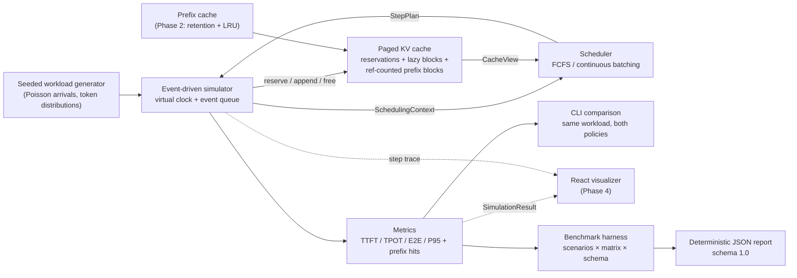

# Architecture

Status: Phase 3 (simulator, prefix cache, benchmark harness, CLI). The web visualizer is
planned, not implemented.

## 1. Purpose and scope

LLM Serving Lab is a small, deterministic sandbox for studying how LLM request scheduling
policies behave. It runs on a 16 GB Apple Silicon laptop because **it does not execute a
model**. It simulates an inference server with an analytical latency model, an event-driven
clock, and a paged KV-cache allocator.

The lab is designed to answer questions such as:

- Why does naive FCFS suffer from head-of-line blocking?
- How much do iteration-level batching and chunked prefill help throughput and TTFT?
- How does KV-cache capacity bound the number of concurrent requests?
- How much prefill work do reusable prompt prefixes save, and what memory do they retain?
- How do batch size, token budget, and prefill chunk size trade off TTFT against TPOT?
- Which scheduling configuration wins across steady, bursty, prefix-heavy, short-chat, and
  long-context workloads under one reproducible benchmark matrix?

### What is simulated

- Every latency, throughput, and cache statistic comes from a synthetic cost model.
- No transformer weights are loaded. No GPU, CUDA, Metal, or Ascend runtime is used.
- The workload is synthetic: Poisson arrivals, clamped-normal token counts, and declared
  shared-prefix identities (there is no real prompt text to hash).

### What is real

- The event loop, request state machine, schedulers, KV allocator, capacity checks, metric
  aggregation, and test suite are real software. The numbers are derived from them.
- The same core will drive the React visualizer in a later phase, so UI and scheduling logic
  cannot drift apart.

## 2. Constraints

| Constraint | Consequence |
| --- | --- |
| 16 GB Apple Silicon laptop | No local 7B+ inference dependency; simulation-only core. |
| Reproducibility | Seeded PRNG, no wall-clock reads, deterministic tie-breaking. |
| Testability | Pure scheduler functions; engine validates every plan. |
| Honest reporting | CLI and docs label all output as simulated. No fabricated hardware results. |
| Incremental delivery | Each phase stays small; each later milestone adds one subsystem. |

## 3. Component map



The core (`src/core`) has no DOM, React, or Node-only dependencies. The CLI is a thin adapter.
A future web app can import the exact same types and results.

## 4. Event-driven simulation

### Virtual clock

Time is a float in milliseconds. No steps sleep; the engine jumps from event to event.

Two event kinds are stored in a binary min-heap ordered by `(time, insertionSequence)`:

- **arrival** — a request reaches the server and joins the waiting queue.
- **step** — the engine performs one scheduling iteration.

The insertion sequence is the tie-breaker. This makes same-millisecond ordering deterministic,
including "arrivals at time T are queued before the step at time T".

### Main loop

```text
push all arrival events
schedule the first step at the first arrival time
while events remain:
  pop the earliest event
  if arrival:
    advance now to max(now, event.time)
    enqueue request; schedule a step if idle
  else:
    run one step at `now`
    advance now by the step latency
    schedule the next step if waiting or running requests remain
```

Steps execute as an atomic chunk of work. Tokens generated by a step are timestamped at the
**end** of that step, which is when their latency has been paid.

### Request lifecycle

```mermaid
stateDiagram-v2
  [*] --> waiting: arrival
  waiting --> prefill: admitted + KV reserved
  prefill --> prefill: prompt chunk computed
  prefill --> decode: prompt complete; token 1 emitted
  decode --> decode: one token per step
  prefill --> finished: maxNewTokens == 1
  decode --> finished: maxNewTokens reached
  finished --> [*]: KV blocks and reservation freed
```



Prefill produces the first output token. Therefore:

- TTFT = end of the prefill step − arrival time.
- A request with `maxNewTokens = 1` finishes when prefill completes.
- TPOT is undefined for one-token responses and excluded from TPOT aggregation.
- The token budget counts prefill positions plus one position per decoding sequence. The
  first output token is produced by the prefill step, so it is not an extra decode position.

### Determinism

- `mulberry32` seeded PRNG for workload generation; no `Math.random()` in the core.
- No `Date.now()` or wall-clock data in simulation results.
- Heap ties break by insertion sequence.
- Requests with equal arrival times keep their input order.
- All configs and results are plain JSON-serializable data.
- Tests assert byte-identical step traces for repeated runs.

## 5. Schedulers

The engine owns all mutable state. A scheduler receives a read-only `SchedulingContext` and
returns a `StepPlan`:

```ts
interface StepPlan {
  admit: string[]                            // waiting request IDs to admit
  prefill: { requestId: string; tokens: number }[]  // prompt chunks
  decode: string[]                           // running decode request IDs
}
```

Schedulers are deterministic and side-effect free. The engine validates every plan **before**
mutating state and throws `PlanValidationError` on a violation.

### Plan invariants enforced by the engine

- Admitted requests are currently waiting and have no KV reservation.
- Every admitted request has a positive prefill intent.
- Prefill targets an admitted request or a running request in the `prefill` phase.
- Prefill never exceeds the remaining prompt tokens.
- Decode targets a running request that completed prefill and has remaining output budget.
- A request cannot prefill and decode in the same step.
- `prefillTokens + decodeTokens <= maxNumBatchedTokens`.
- `running + admitted <= maxBatchSize`.
- New admissions fit in `cache.availableBlocks` (cumulative KV headroom).
- An empty plan while work remains is reported as `SimulationStalledError` instead of looping.

### FCFS (sequential baseline)

`src/core/schedulers/fcfs.ts`

- If a request is running, decode it (or continue its prompt chunk). Never admit another.
- If idle, admit the queue head and prefill up to `prefillChunkSize`.
- Prompt prefill is chunked only to respect the token budget; there is no batching, no overlap.

This is deliberately the naive baseline. It shows head-of-line blocking: one slow request
occupies the only slot while the KV cache and token budget sit idle.

### Continuous batching

`src/core/schedulers/continuous-batching.ts`

Each step, in priority order:

1. **Decode first** — every running decode request gets one token, up to the token budget.
   This protects in-flight streams from prefill budget and slot pressure. A mixed step still
   pays both prefill and decode latency; decode-first is a scheduling priority, not isolation.
2. **Continue prefills** — running requests still in prefill get a chunk in FIFO order.
3. **Admit** — waiting requests are admitted FIFO while batch slots, token budget, and KV
   headroom remain. A chunk is prefilled immediately.

Admission is deliberately strict FIFO: a head-of-line request that does not fit current KV
headroom blocks later, smaller requests. That is a policy choice, not an engine limitation, and
keeps the comparison with FCFS clean. Prefix-aware or size-aware admission is a later exercise.

### Why TPOT can get worse

Batching raises aggregate throughput and usually improves TTFT under load, but a decode step
that includes prefill work or many sequences is slower than a single-stream decode step. The
default demo therefore shows higher TPOT for continuous batching alongside lower E2E P95 and
higher throughput. This trade-off is intentional and visible.

## 6. Paged KV cache

`src/core/kv-cache.ts`

### Blocks and reservations

- The cache is `totalBlocks` fixed-size blocks of `blockSize` token slots.
- Defaults: 2,048 blocks × 16 tokens = 32,768 token slots.
- A request reserves `ceil((promptTokens + maxNewTokens) / blockSize)` blocks at admission.
- Blocks are appended lazily as tokens are computed. A block is physically owned only when a
  sequence position first needs it.
- A request may declare a synthetic prefix identity (`prefix.key`) and a prefix length. Whole
  cached blocks of that prefix are shared by reference; the cache lookup happens at admission.
- On completion, exclusive blocks are released. Prefix blocks that became cacheable are
  retained while still valid, even after their last owner finishes.

### Accounting model

| Field | Meaning |
| --- | --- |
| `allocatedBlocks` | Unique physical blocks referenced by at least one active request. |
| `cachedBlocks` | Retained prefix blocks with ref-count 0 (idle, evictable). |
| `physicalBlocks` | `allocatedBlocks + cachedBlocks`: the real memory footprint. |
| `logicalBlocks` | Sum of active block-table lengths; shared blocks count once per request. |
| `sharedBlocks` | Active physical blocks referenced by more than one request. |
| `reservedBlocks` | Worst-case blocks promised to active requests. |
| `availableBlocks` | `totalBlocks - reservedBlocks`; the headroom admission control uses. |
| `freeAllocatedBlocks` | `totalBlocks - physicalBlocks`; physically free right now. |
| `peak*` | High-water marks used by the summary and future UI. |

Invariants (checked by `cache.validate()` in tests, property tests, and at the end of every
simulation):

- Every block ID is in range and free blocks are disjoint from used blocks.
- Ref-counts equal the number of active request tables referencing each block.
- A shared logical block maps to exactly one physical block.
- Cached idle blocks are tracked in the idle set; active/non-cached blocks are not.
- Prefix-index keys point only at cached blocks and agree with per-block metadata.
- Every cached block has a valid key; every prefix-index key has exactly one block.
- `allocatedTokens <= reservedTokens` per request.
- Block-table length equals `ceil(allocatedTokens / blockSize)`.
- Sum of per-request reservations equals the cache counter and never exceeds capacity.
- `physicalBlocks = allocatedBlocks + cachedBlocks <= totalBlocks`.

### Prefix cache (Phase 2)

`PrefixReservation` carries a synthetic `key` and a requested token count. Because the
simulator has no token text, the key stands in for a real content hash. The workload generator
creates keys such as `prefix-2`; a real implementation would hash token blocks (optionally
chaining the parent hash) and compare those hashes.

- **Matching:** only whole blocks match. The declared prefix length is floored to a multiple of
  `blockSize`. Lookup walks block indices from zero and stops at the first miss, so a hit is
  always a contiguous prefix chain.
- **Admission cap:** the engine caps hits at `promptTokens - 1` (then floors to a block). This
  guarantees at least one prompt token remains, so the normal prefill-first-token path and
  `maxNewTokens = 1` edge cases stay uniform. It under-uses a prefix that covers the entire
  prompt; this is an explicit simplification.
- **Planned intents are clamped:** schedulers plan before the cache lookup. If a hit reduces
  the remaining prompt, the engine clamps that request's prefill intent to the suffix and
  recomputes the step latency from the tokens actually computed.
- **Registration:** as prefill fills a block wholly inside the declared prefix, that block is
  marked cached and inserted into the prefix index. If the key is already mapped to another
  block, the new block stays exclusive to avoid duplicate cache entries.
- **Retention and eviction:** finishing a request releases references. A prefix block with no
  remaining references becomes idle and stays cached; exclusive blocks are freed. When an
  allocation needs a block and the free list is empty, the least-recently-used *idle cached*
  block is evicted. Active shared blocks are never candidates.
- **Reservations do not shrink:** admission still reserves the full worst-case sequence. Hits
  reduce prefill compute and physical duplication, but not admission headroom. This keeps the
  deadlock-freedom proof simple. Prefix-aware reservation accounting is a later refinement.
- **Duplicate work is possible:** if two requests both miss and compute the same prefix before
  either registers the blocks, one of the duplicate blocks is not inserted into the index and
  is freed when its owner finishes.

### Why reserve the worst case?

Lazy allocation alone can deadlock: if every running sequence needs a new block at the same
step and the cache is full, none can finish, so none can release. The simulator avoids this
with a per-request worst-case reservation, which guarantees every admitted request can run to
completion. Prefix sharing is layered on top without weakening that guarantee: shared blocks
count toward each owner's reservation, which over-counts them but keeps admission safe.

The cost is reduced admission concurrency: reserved-but-not-yet-used blocks cannot be promised
to another request. Precise prefix-aware reservations would require accounting for blocks that
are already active versus merely retained, plus preemption or stalling.

Preemption (evicting a running request and recomputing later), swapping, and exact admission
with stalling remain deliberately deferred.

### Why paging at all if reservations are worst-case?

Reservations are admission bookkeeping; physical allocation is still paged and lazy. Paging
avoids contiguous-growth requirements, supports per-request block tables, enables ref-counted
prefix sharing, and gives the UI a natural visualization unit: a block map.

## 7. Synthetic cost model

`src/core/cost-model.ts`

All costs are milliseconds. For a step with `P` prefill tokens and `D` decoding sequences:

```text
latency =
    stepOverheadMs
  + (P > 0 ? prefillBaseMs + P * prefillMsPerToken : 0)
  + (D > 0 ? decodeBaseMs  + D * decodeMsPerRequest : 0)
```

| Parameter | Default | Rationale |
| --- | ---: | --- |
| `stepOverheadMs` | 0.2 | Scheduler/bookkeeping overhead per step. |
| `prefillBaseMs` | 2.0 | Kernel launch/fixed prefill cost. |
| `prefillMsPerToken` | 0.35 | Prefill is modelled as compute-bound and linear. |
| `decodeBaseMs` | 18.0 | Weight read per decode step, roughly constant in batch size. |
| `decodeMsPerRequest` | 1.2 | Per-sequence KV read/compute; sublinear batching benefit. |

Example: a 16-request decode step costs `0.2 + 18 + 16 × 1.2 = 37.4 ms` for 16 tokens,
while 16 single-request steps cost `16 × 19.4 = 310.4 ms`. This sublinear decode assumption is
the main reason continuous batching wins in the simulation.

**These values are illustrative, not measurements.** They are chosen to be in a plausible
order of magnitude for a 7B-class 4-bit model and to make scheduling effects visible. Prefix
hits do reduce the prefill token count, but the model does not include cache-lookup/hash cost,
memory-bandwidth contention, attention quadratic effects, network latency, or hardware
variance. Replace the model with measured traces before drawing performance conclusions.

## 8. Metrics

| Metric | Definition |
| --- | --- |
| TTFT | `firstTokenAt - arrivalTime` |
| TPOT | `(finishedAt - firstTokenAt) / (outputTokens - 1)`, per request; `null` if one token |
| E2E | `finishedAt - arrivalTime` |
| Throughput (req/s) | `completedRequests / (makespan / 1000)` |
| Output throughput | `sum(outputTokens) / (makespan / 1000)` |
| Makespan | `max(finishedAt) - min(arrivalTime)` |
| P50 / P95 / P99 | Linear interpolation over the sorted sample |
| Avg decode batch | Mean decode sequences over steps that decoded at least one token |
| Prefix hit tokens | Prompt tokens served from whole cached prefix blocks |
| Prefix token hit rate | `sum(prefixHitTokens) / sum(promptTokens)` over completed requests |
| Prefix request hit rate | Requests with at least one prefix block reused / completed requests |
| KV physical peak | Peak `allocatedBlocks + cachedBlocks`; sharing counted once |
| KV logical-active peak | Peak sum of active block-table lengths; sharing counted per request |
| KV shared peak | Peak active blocks referenced by more than one request |
| KV retained peak | Peak idle cached blocks held for future reuse |
| KV peak | High-water marks from the allocator |

The throughput denominator includes ramp-up and drain time. Workloads with different arrival
rates are therefore not directly comparable unless makespan semantics are considered.

## 9. Benchmark harness

`src/core/benchmark.ts` (pure) and `src/cli/bench.ts` (Node file/stdio adapter).

Five scenarios cover different pressure points:

| Scenario | Requests | Arrival rate | Mean prompt / output | Purpose |
| --- | ---: | ---: | ---: | --- |
| `steady` | 60 | 1.5 req/s | 512 / 128 | baseline queueing |
| `bursty` | 80 | 6 req/s | 256 / 96 | deliberate overload |
| `prefix-heavy` | 60 | 1.5 req/s | 512 / 96 | 90% share two 256-token prefixes |
| `short-chat` | 80 | 4 req/s | 96 / 48 | short requests at high rate |
| `long-context` | 24 | 0.5 req/s | 2048 / 96 | KV capacity pressure |

The default matrix crosses scheduler (`fcfs`, `continuous-batching`) × batch size (8, 16) ×
prefill chunk (256, 512) × KV capacity (1,024 / 2,048 blocks): 80 runs in about a second on
the development machine. The report preserves every axis; the CLI table shows representative
baseline cells and a best-throughput cell when it improves on the baseline.

The report includes:

- `schemaVersion: "1.0"` and `costModelVersion: "synthetic-v1"` so consumers can detect shape
  or cost-model drift.
- The seed, normalized matrix axes, every workload config, and every engine config.
- Per-run summaries: throughput, TTFT/TPOT/E2E P50/P95/P99, prefix hit metrics, KV peaks.
- No wall-clock timestamp, so identical options produce byte-identical JSON.
- No per-request traces or steps; those stay in the live simulator for the future UI. The report
  is summary-only to stay small and stable.

`pnpm bench` writes `bench-results.json`; `pnpm bench --smoke --json` emits a two-run report to
stdout for CI. `--out`, `--scenario` (repeatable), `--seed`, and the three matrix axes are
available from the CLI. A benchmark report is a simulation artifact and is never presented as
a hardware measurement.

## 10. Design decisions

| Decision | Alternatives considered | Choice and trade-off |
| --- | --- | --- |
| TypeScript core, single package | Python core + TS UI; pnpm monorepo | Shared types with the future React UI, zero runtime dependencies, one install. Not a real serving engine. |
| Event-driven clock | Fixed 1 ms ticks | Exact step boundaries and instant idle jumps; slightly more bookkeeping. |
| Scheduler returns a plan | Scheduler mutates engine state | Easy to unit-test and validate; plans can be rejected before mutation. |
| Worst-case KV reservation | Stalling, preemption, exact reservation | Deadlock-free and deterministic, but limits concurrency. Preemption and prefix-aware admission are later milestones. |
| Retained prefix cache | No retention; active-request sharing only | Hits work across idle gaps and show real memory retention; adds ref-counts, LRU eviction, and prefix-index invariants. |
| Synthetic prefix keys | Real token hashes / radix tree | Reproducible without prompt text; not a content-addressed cache. Real hashing is an extension. |
| Chunked prefill | Prefill whole prompts only | Keeps per-step latency and token budget bounded; introduces prefill/decode interference. |
| Analytical cost model | Microbenchmark traces | Runs anywhere, reproducible, no hardware claims. Must be replaced for quantitative conclusions. |
| Benchmark matrix + versioned JSON | Ad-hoc one-off runs | Same scenarios/seed produce byte-identical reports; schema and cost-model versions make changes explicit. Summary-only by design. |
| FIFO admission only | Shortest-job-first, prefix-aware | Keeps FCFS vs batching comparison controlled; advanced policies are extensions. |

## 11. Extension points

### Prefix-aware admission and real hashing

- Hash real token blocks (optionally chained with the parent hash) instead of synthetic keys.
- Relax full-sequence reservations for prefix hits by distinguishing active shared blocks,
  evictable retained blocks, and genuinely exclusive future allocations.
- Model cache lookup and hashing latency; currently a hit is free beyond skipped prefill.
- Add preemption so an over-committed cache can reclaim active blocks deterministically.
- Expose per-block metadata (key, ref-count, last-used, cached) in a trace for the UI.

### Report explorer and scenario editor

- Import a benchmark JSON report in the React app and compare cells without rerunning.
- Add scenario editing while keeping `schemaVersion` explicit.
- Optionally include sampled step traces in a separate artifact; keep the summary report stable.

### React visualizer

- Vite + React + TypeScript, importing `src/core`.
- Timeline playback of `SimulationResult.steps`.
- Queue and request-state table; KV block grid; summary comparison charts.
- Core remains headless: the UI only reads results and never schedules requests itself.

### UI decoupling

`src/core` must not import DOM APIs, React, or Node built-ins. The CLI may use Node APIs. Keep
new interfaces JSON-serializable so the browser can consume them without adapters.

## 12. Known limitations

- No real model execution, GPU/NPU, CUDA, Metal, or Ascend integration.
- No preemption, swapping, or failure injection; KV admission remains worst-case.
- Prefix cache keys are synthetic identifiers, not hashes of real tokens; content collisions and
  chained-hash semantics are not modelled.
- Prefix hits reduce prefill tokens but do not relax admission headroom. Two concurrent misses
  can duplicate work for the same prefix.
- Prefix-cache lookup, hashing, and block-table setup are not charged any latency.
- No speculative decoding, priorities, deadlines, or multi-tenant fairness.
- Cost model ignores attention length effects, memory-bandwidth contention, and hardware
  variance.
- Benchmark reports intentionally omit per-request traces and step timelines; use the live
  simulator or a future artifact for those.
- Single-node, single-model, homogeneous requests.

## 13. References

- vLLM / PagedAttention: <https://arxiv.org/abs/2309.06180>
- Orca continuous batching: <https://www.usenix.org/conference/osdi22/presentation/yu>
- No third-party code was copied from Mini-SGLang, vLLM, or any other serving project.
