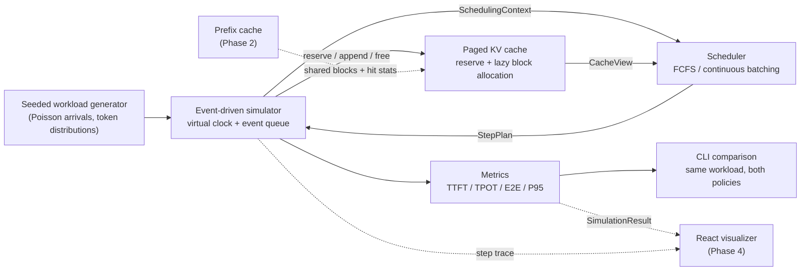

# Architecture

Status: Phase 1 (working simulator + CLI). The web visualizer and prefix cache are planned, not implemented.

## 1. Purpose and scope

LLM Serving Lab is a small, deterministic sandbox for studying how LLM request scheduling
policies behave. It runs on a 16 GB Apple Silicon laptop because **it does not execute a
model**. It simulates an inference server with an analytical latency model, an event-driven
clock, and a paged KV-cache allocator.

The lab is designed to answer questions such as:

- Why does naive FCFS suffer from head-of-line blocking?
- How much do iteration-level batching and chunked prefill help throughput and TTFT?
- How does KV-cache capacity bound the number of concurrent requests?
- How do batch size, token budget, and prefill chunk size trade off TTFT against TPOT?

### What is simulated

- Every latency, throughput, and cache statistic comes from a synthetic cost model.
- No transformer weights are loaded. No GPU, CUDA, Metal, or Ascend runtime is used.
- The workload is synthetic: Poisson arrivals and clamped-normal token counts.

### What is real

- The event loop, request state machine, schedulers, KV allocator, capacity checks, metric
  aggregation, and test suite are real software. The numbers are derived from them.
- The same core will drive the React visualizer in a later phase, so UI and scheduling logic
  cannot drift apart.

## 2. Constraints

| Constraint | Consequence |
| --- | --- |
| 16 GB Apple Silicon laptop | No local 7B+ inference dependency; simulation-only core. |
| Reproducibility | Seeded PRNG, no wall-clock reads, deterministic tie-breaking. |
| Testability | Pure scheduler functions; engine validates every plan. |
| Honest reporting | CLI and docs label all output as simulated. No fabricated hardware results. |
| Incremental delivery | Phase 1 stays small; each later milestone adds one subsystem. |

## 3. Component map



The core (`src/core`) has no DOM, React, or Node-only dependencies. The CLI is a thin adapter.
A future web app can import the exact same types and results.

## 4. Event-driven simulation

### Virtual clock

Time is a float in milliseconds. No steps sleep; the engine jumps from event to event.

Two event kinds are stored in a binary min-heap ordered by `(time, insertionSequence)`:

- **arrival** — a request reaches the server and joins the waiting queue.
- **step** — the engine performs one scheduling iteration.

The insertion sequence is the tie-breaker. This makes same-millisecond ordering deterministic,
including "arrivals at time T are queued before the step at time T".

### Main loop

```text
push all arrival events
schedule the first step at the first arrival time
while events remain:
  pop the earliest event
  if arrival:
    advance now to max(now, event.time)
    enqueue request; schedule a step if idle
  else:
    run one step at `now`
    advance now by the step latency
    schedule the next step if waiting or running requests remain
```

Steps execute as an atomic chunk of work. Tokens generated by a step are timestamped at the
**end** of that step, which is when their latency has been paid.

### Request lifecycle

```mermaid
stateDiagram-v2
  [*] --> waiting: arrival
  waiting --> prefill: admitted + KV reserved
  prefill --> prefill: prompt chunk computed
  prefill --> decode: prompt complete; token 1 emitted
  decode --> decode: one token per step
  prefill --> finished: maxNewTokens == 1
  decode --> finished: maxNewTokens reached
  finished --> [*]: KV blocks and reservation freed
```



Prefill produces the first output token. Therefore:

- TTFT = end of the prefill step − arrival time.
- A request with `maxNewTokens = 1` finishes when prefill completes.
- TPOT is undefined for one-token responses and excluded from TPOT aggregation.
- The token budget counts prefill positions plus one position per decoding sequence. The
  first output token is produced by the prefill step, so it is not an extra decode position.

### Determinism

- `mulberry32` seeded PRNG for workload generation; no `Math.random()` in the core.
- No `Date.now()` or wall-clock data in simulation results.
- Heap ties break by insertion sequence.
- Requests with equal arrival times keep their input order.
- All configs and results are plain JSON-serializable data.
- Tests assert byte-identical step traces for repeated runs.

## 5. Schedulers

The engine owns all mutable state. A scheduler receives a read-only `SchedulingContext` and
returns a `StepPlan`:

```ts
interface StepPlan {
  admit: string[]                            // waiting request IDs to admit
  prefill: { requestId: string; tokens: number }[]  // prompt chunks
  decode: string[]                           // running decode request IDs
}
```

Schedulers are deterministic and side-effect free. The engine validates every plan **before**
mutating state and throws `PlanValidationError` on a violation.

### Plan invariants enforced by the engine

- Admitted requests are currently waiting and have no KV reservation.
- Every admitted request has a positive prefill intent.
- Prefill targets an admitted request or a running request in the `prefill` phase.
- Prefill never exceeds the remaining prompt tokens.
- Decode targets a running request that completed prefill and has remaining output budget.
- A request cannot prefill and decode in the same step.
- `prefillTokens + decodeTokens <= maxNumBatchedTokens`.
- `running + admitted <= maxBatchSize`.
- New admissions fit in `cache.availableBlocks` (cumulative KV headroom).
- An empty plan while work remains is reported as `SimulationStalledError` instead of looping.

### FCFS (sequential baseline)

`src/core/schedulers/fcfs.ts`

- If a request is running, decode it (or continue its prompt chunk). Never admit another.
- If idle, admit the queue head and prefill up to `prefillChunkSize`.
- Prompt prefill is chunked only to respect the token budget; there is no batching, no overlap.

This is deliberately the naive baseline. It shows head-of-line blocking: one slow request
occupies the only slot while the KV cache and token budget sit idle.

### Continuous batching

`src/core/schedulers/continuous-batching.ts`

Each step, in priority order:

1. **Decode first** — every running decode request gets one token, up to the token budget.
   This protects in-flight streams from prefill budget and slot pressure. A mixed step still
   pays both prefill and decode latency; decode-first is a scheduling priority, not isolation.
2. **Continue prefills** — running requests still in prefill get a chunk in FIFO order.
3. **Admit** — waiting requests are admitted FIFO while batch slots, token budget, and KV
   headroom remain. A chunk is prefilled immediately.

Admission is deliberately strict FIFO: a head-of-line request that does not fit current KV
headroom blocks later, smaller requests. That is a policy choice, not an engine limitation, and
keeps the comparison with FCFS clean. Prefix-aware or size-aware admission is a later exercise.

### Why TPOT can get worse

Batching raises aggregate throughput and usually improves TTFT under load, but a decode step
that includes prefill work or many sequences is slower than a single-stream decode step. The
default demo therefore shows higher TPOT for continuous batching alongside lower E2E P95 and
higher throughput. This trade-off is intentional and visible.

## 6. Paged KV cache

`src/core/kv-cache.ts`

### Blocks and reservations

- The cache is `totalBlocks` fixed-size blocks of `blockSize` token slots.
- Defaults: 2,048 blocks × 16 tokens = 32,768 token slots.
- A request reserves `ceil((promptTokens + maxNewTokens) / blockSize)` blocks at admission.
- Blocks are appended lazily as tokens are computed. A block is physically owned only when a
  sequence position first needs it.
- On completion (or error), all blocks and the reservation are released.

### Accounting model

| Field | Meaning |
| --- | --- |
| `allocatedBlocks` | Blocks holding real tokens right now. |
| `reservedBlocks` | Worst-case blocks promised to active requests. Always ≥ allocated. |
| `availableBlocks` | `totalBlocks - reservedBlocks`; the headroom admission control uses. |
| `freeAllocatedBlocks` | `totalBlocks - allocatedBlocks`; physically unused right now. |
| `peakAllocatedBlocks` | High-water mark of the real footprint. |
| `peakReservedBlocks` | High-water mark of reservations. |

Invariants (checked by `cache.validate()` in tests and property tests):

- Every block ID is in range and owned by at most one request.
- A block is either free or allocated, never both.
- `allocatedTokens <= reservedTokens` per request.
- Block-table length equals `ceil(allocatedTokens / blockSize)`.
- Sum of per-request reservations equals the cache counter and never exceeds capacity.

### Why reserve the worst case?

Lazy allocation alone can deadlock: if every running sequence needs a new block at the same
step and the cache is full, none can finish, so none can release. Phase 1 avoids this with a
per-request worst-case reservation, which guarantees every admitted request can run to
completion. The cost is reduced admission concurrency: reserved-but-not-yet-used blocks cannot
be promised to another request.

Preemption (evicting a running request and recomputing later), exact admission with stalling,
and block sharing are deliberately deferred. The allocator is small enough to extend without
rewriting the engine.

### Why paging at all if reservations are worst-case?

Reservations are admission bookkeeping; physical allocation is still paged and lazy. Paging
avoids contiguous-growth requirements, supports per-request block tables, and is the structure
prefix sharing will need. It also gives the UI a natural visualization unit: a block map.

## 7. Synthetic cost model

`src/core/cost-model.ts`

All costs are milliseconds. For a step with `P` prefill tokens and `D` decoding sequences:

```text
latency =
    stepOverheadMs
  + (P > 0 ? prefillBaseMs + P * prefillMsPerToken : 0)
  + (D > 0 ? decodeBaseMs  + D * decodeMsPerRequest : 0)
```

| Parameter | Default | Rationale |
| --- | ---: | --- |
| `stepOverheadMs` | 0.2 | Scheduler/bookkeeping overhead per step. |
| `prefillBaseMs` | 2.0 | Kernel launch/fixed prefill cost. |
| `prefillMsPerToken` | 0.35 | Prefill is modelled as compute-bound and linear. |
| `decodeBaseMs` | 18.0 | Weight read per decode step, roughly constant in batch size. |
| `decodeMsPerRequest` | 1.2 | Per-sequence KV read/compute; sublinear batching benefit. |

Example: a 16-request decode step costs `0.2 + 18 + 16 × 1.2 = 37.4 ms` for 16 tokens,
while 16 single-request steps cost `16 × 19.4 = 310.4 ms`. This sublinear decode assumption is
the main reason continuous batching wins in the simulation.

**These values are illustrative, not measurements.** They are chosen to be in a plausible
order of magnitude for a 7B-class 4-bit model and to make scheduling effects visible. They do
not model memory bandwidth precisely, attention quadratic costs, prefix-cache hits, network
latency, or hardware variance. Replace them with measured traces before drawing performance
conclusions.

## 8. Metrics

| Metric | Definition |
| --- | --- |
| TTFT | `firstTokenAt - arrivalTime` |
| TPOT | `(finishedAt - firstTokenAt) / (outputTokens - 1)`, per request; `null` if one token |
| E2E | `finishedAt - arrivalTime` |
| Throughput (req/s) | `completedRequests / (makespan / 1000)` |
| Output throughput | `sum(outputTokens) / (makespan / 1000)` |
| Makespan | `max(finishedAt) - min(arrivalTime)` |
| P50 / P95 / P99 | Linear interpolation over the sorted sample |
| Avg decode batch | Mean decode sequences over steps that decoded at least one token |
| KV peak | High-water marks from the allocator |

The throughput denominator includes ramp-up and drain time. Workloads with different arrival
rates are therefore not directly comparable unless makespan semantics are considered.

## 9. Design decisions

| Decision | Alternatives considered | Choice and trade-off |
| --- | --- | --- |
| TypeScript core, single package | Python core + TS UI; pnpm monorepo | Shared types with the future React UI, zero runtime dependencies, one install. Not a real serving engine. |
| Event-driven clock | Fixed 1 ms ticks | Exact step boundaries and instant idle jumps; slightly more bookkeeping. |
| Scheduler returns a plan | Scheduler mutates engine state | Easy to unit-test and validate; plans can be rejected before mutation. |
| Worst-case KV reservation | Stalling, preemption, exact reservation | Deadlock-free and deterministic, but limits concurrency. Preemption is a later milestone. |
| Chunked prefill | Prefill whole prompts only | Keeps per-step latency and token budget bounded; introduces prefill/decode interference. |
| Analytical cost model | Microbenchmark traces | Runs anywhere, reproducible, no hardware claims. Must be replaced for quantitative conclusions. |
| FIFO admission only | Shortest-job-first, prefix-aware | Keeps FCFS vs batching comparison controlled; advanced policies are extensions. |

## 10. Extension points

### Prefix cache (next)

- Hash block contents (optionally chained with the parent block hash).
- Ref-count shared blocks; a request's block table may reference shared blocks.
- Add `prefixHitTokens` / `prefixHitBlocks` to request outcomes and summaries.
- Keep the same `CacheView` contract; admission uses physical plus shared-block accounting.
- Test eviction, ref-counts, and hit-rate edge cases before wiring the UI.

### Benchmark harness

- Scenario definitions (steady, bursty, prefix-heavy) with fixed seeds.
- Run a config matrix and export summary JSON with an explicit `simulated: true` flag.
- Add P99 and time-series traces for the UI.
- Never commit numbers presented as hardware results.

### React visualizer

- Vite + React + TypeScript, importing `src/core`.
- Timeline playback of `SimulationResult.steps`.
- Queue and request-state table; KV block grid; summary comparison charts.
- Core remains headless: the UI only reads results and never schedules requests itself.

### UI decoupling

`src/core` must not import DOM APIs, React, or Node built-ins. The CLI may use Node APIs. Keep
new interfaces JSON-serializable so the browser can consume them without adapters.

## 11. Known limitations

- No real model execution, GPU/NPU, CUDA, Metal, or Ascend integration.
- No preemption, swapping, or eviction; KV reservation is worst-case.
- No prefix sharing yet.
- No speculative decoding, priorities, deadlines, or multi-tenant fairness.
- Cost model ignores attention length effects, memory-bandwidth contention, and hardware
  variance.
- Synthetic prompts have no content; "prefix reuse" cannot be meaningful until Phase 2 adds
  shared prefixes to the workload generator.
- Single-node, single-model, homogeneous requests.

## 12. References

- vLLM / PagedAttention: <https://arxiv.org/abs/2309.06180>
- Orca continuous batching: <https://www.usenix.org/conference/osdi22/presentation/yu>
- No third-party code was copied from Mini-SGLang, vLLM, or any other serving project.
