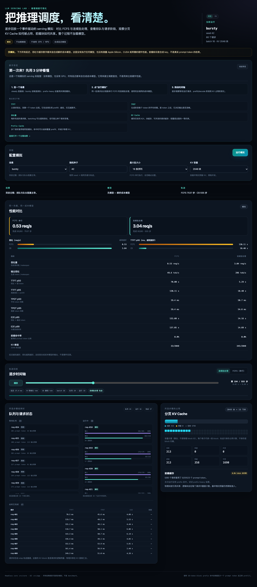

# LLM Serving Lab

> A deterministic, event-driven lab for understanding LLM request scheduling on a 16 GB
> Apple Silicon laptop — without running a model or owning a GPU.

**Phase 5 (P0) status:** event-driven simulator, FCFS and continuous batching, paged KV cache,
retained prefix cache, seeded benchmark matrix, bilingual React trace visualizer, plus Biome
lint/format, coverage gates, a versioned benchmark JSON Schema, Node 22/24 CI, and contributor docs.

[](https://github.com/lmjshineee/tiny-llm-server/actions/workflows/ci.yml)
[](https://github.com/lmjshineee/tiny-llm-server/actions/workflows/pages.yml)

**Live demo:** <https://lmjshineee.github.io/tiny-llm-server/>

> [!IMPORTANT]
> **Everything here is simulated.** No transformer is executed, no CUDA/Metal/Ascend runtime is
> used, and every latency or throughput number comes from a synthetic analytical cost model.
> There are no fabricated hardware benchmark results in this repository.

## Why this exists

Scheduling is where much of LLM serving performance is won or lost, but experimenting with a
real serving stack on a laptop is awkward: model weights, GPU memory, and long benchmark runs
get in the way of the actual question — *what does the scheduler do?*

This project isolates that question:

- An event-driven virtual clock with explicit prefill and decode phases.
- A naive FCFS baseline versus iteration-level continuous batching.
- A paged KV-cache allocator with capacity limits, reservations, and per-request block tables.
- An optional prefix cache that shares whole prompt blocks by reference, retains them after
  their owners finish, and evicts idle entries LRU under pressure.
- A reproducible Poisson workload generator and a comparison of throughput, TTFT, TPOT, and
  P95/P99 latency under the same seed.
- A benchmark harness with five scenarios, a scheduler/batch/chunk/KV matrix, and a versioned
  deterministic JSON report.
- A headless core plus a React visualizer for timeline playback, queue/request states, KV
  occupancy, and FCFS-vs-continuous-batching comparison.

## Quick start

Requirements: Node.js ≥ 22.12 and pnpm (developed with Node 24.22.2 and pnpm 12.18.0). The
verified development machine is an Apple M5 with 16 GB RAM running macOS 27.3. No model, GPU,
or network access is needed after installation.

```bash
pnpm install
pnpm demo                 # run both schedulers on the default seeded workload
pnpm demo --prefix-cache  # enable shared-prefix workload + retained prefix cache
pnpm bench                # 80-run scenario matrix -> bench-results.json
pnpm bench --smoke --json # fast deterministic matrix for CI/scripts
pnpm dev:web              # Vite dev server at http://localhost:5173
pnpm build:web            # production visualizer bundle -> dist-web/
pnpm test                 # unit, property, benchmark, and UI tests
pnpm test:coverage        # coverage report with thresholds
pnpm lint                 # Biome lint
pnpm format:check         # Biome formatting check
pnpm typecheck            # strict TypeScript
pnpm check                # typecheck + lint + tests
```

Useful demo flags:

```bash
pnpm demo --requests 120 --rate 3 --seed 7
pnpm demo --prompt-mean 1024 --output-mean 64 --max-batch 8 --blocks 1024
pnpm demo --prefix-cache --prefix-pool 2 --prefix-tokens 512 --prefix-prob 0.9
pnpm demo --json > results.json
pnpm demo --help

pnpm bench --scenario prefix-heavy --batch-sizes 8,16 --chunks 256 --kv-blocks 1024
pnpm bench --out bench-results.json
pnpm bench --help

pnpm bench --smoke --json > bench-smoke.json
pnpm validate:bench bench-smoke.json   # JSON Schema validation
```

## Visualizer

**Live demo:** <https://lmjshineee.github.io/tiny-llm-server/>

The React app is a thin consumer of `SimulationResult`; the scheduler core stays headless.



*Chinese UI with the beginner guide open. The bursty scenario is at step 194/555; every number
is simulated.*

- Scenario, seed, batch-size, and KV-capacity controls; runs both policies against identical
  requests.
- Comparison of throughput, TTFT/TPOT/E2E P50/P95/P99, prefix hit rate, and KV peaks.
- Step timeline with playback and scheduler tabs.
- Waiting queue, running prefill/decode states, per-request prompt/output progress, prefix hits,
  and logical block counts.
- Paged KV occupancy (active/retained/shared/reserved), a capacity map, and prefix-cache stats.
- **Bilingual UI** (中文 / English) with a first-visit guide; the language follows the browser and
  can be switched in the header. Add `?lang=zh` or `?lang=en` to the URL to force one.

A prefix-cache view is available at
[`docs/visualizer-prefix.png`](docs/visualizer-prefix.png). Start the app with:

```bash
pnpm dev:web                 # http://localhost:5173
pnpm build:web               # production bundle -> dist-web/
pnpm preview:web             # preview the production build
```

Deep links initialize the app from the URL:

```text
http://localhost:5173/?scenario=prefix-heavy&tab=continuous-batching&step=0.8&seed=42&lang=zh
```

`scenario`, `seed`, `batch` (4/8/16), `kv` (512/1024/2048), `tab` (`fcfs`/`continuous-batching`),
`step` (0..1 fraction of the trace), and `lang` (`zh`/`en`) are supported. The UI stores occupancy
aggregates, not physical block IDs, so the KV map is explicitly labeled as aggregated.

## Example output

Captured on 2026-11-12 from the default scenario. **Every number below is simulated and is
not a hardware measurement.**

```text
LLM Serving Lab · Phase 5 scheduler + prefix cache
==================================================
SIMULATED — no model is executed and no GPU/NPU is used.

Workload: 80 requests, Poisson @ 1.5 req/s, seed 42
  prompt tokens ~ N(512, 128) clamped to [64, 2048]
  output tokens ~ N(128, 32) clamped to [16, 512]
Engine: maxBatchSize=16, maxNumBatchedTokens=4096, prefillChunkSize=512
KV: 2048 blocks × 16 tokens = 32768 slots; prefix cache off
Cost model: prefill 2.00 + 0.35/token ms; decode 18.00 + 1.20/sequence ms
Prefix workload: off (no shared prefixes generated)

Results (all values simulated)
Strategy                     Req/s   Out tok/s    TTFT p50    TTFT p95    TPOT p50    TPOT p95      E2E p95          Peak KV
───────────────────────────────────────────────────────────────────────────────────────────────────────────────────────────
FCFS (sequential)             0.38          48     78466.6    145867.3        19.4        19.4     148522.2   60/2048 (2.9%)
Continuous batching           1.41         178       282.3       512.7        38.3        52.6       7678.4  590/2048 (28.8%)

Simulated deltas (continuous batching vs FCFS)
  throughput: 3.68×   TTFT p95: 99.6% lower
  completed: 80/80 FCFS, 80/80 continuous

All latency and throughput numbers are produced by a synthetic analytical cost model, not by hardware measurements.
The same 80-request seeded workload and cost model were used for both runs.
These are not Apple Silicon, CUDA, or Ascend hardware measurements.
```

What to notice:

- FCFS finishes one request before admitting the next, so 80 requests queue behind a ~2.6 s
  per-request critical path. TTFT is dominated by queueing, not prefill.
- Continuous batching amortizes decode across up to 16 sequences, raising throughput ~3.7×
  and keeping TTFT bounded.
- Continuous batching's TPOT is *worse* in this scenario (38 ms vs 19 ms). A decode step with
  a batch and mixed prefill work costs more per token per stream. Throughput, TTFT, and TPOT
  are different objectives; the lab makes the trade-off visible instead of hiding it.
- Peak KV differs because batching keeps more requests resident.

### Prefix-cache example

Same base workload, with 75% of requests drawing one of four 256-token prefixes:

```text
$ pnpm demo --prefix-cache
...
FCFS (sequential)             0.39          50     76247.2    140884.2        19.4        19.4     143539.1  112/2048 (5.5%)
Continuous batching           1.42         178       167.6       345.9        31.2        39.8       5875.8  355/2048 (17.3%)

Prefix cache (simulated)
  FCFS (sequential): 58/80 hit requests, 14848/41045 prompt tokens (36.2%)
    KV peak: physical 112, logical-active 60, shared 0, retained 64 blocks
  Continuous batching: 58/80 hit requests, 14848/41045 prompt tokens (36.2%)
    KV peak: physical 355, logical-active 483, shared 48, retained 64 blocks
```

- Hits skip prefill work for matched tokens. Continuous-batching TTFT P50 falls from 282 ms to
  168 ms in this run; the effect on throughput is modest because decode dominates here.
- Physical KV can be *lower* than the sum of block tables (483 logical-active → 355 physical)
  because shared prefix blocks are counted once physically. Retained idle blocks still occupy
  memory, so physical peak includes them.
- Under serial FCFS the physical peak (112) can be *higher* than in the prefix-off run (60):
  cache retention holds 64 idle prefix blocks while only one request is active. Cache memory is
  not free; the benefit there is mostly prefill-token reuse, not footprint.
- Admission still reserves each request's full worst-case sequence. Phase 2 sharing saves
  prefill work and physical duplication, **not** admission headroom. This is deliberate and
  documented; relaxing it requires prefix-aware reservations and preemption.

All prefix identities in the synthetic workload are declared keys, not hashes of real tokens.

## Benchmark harness

`pnpm bench` runs a deterministic matrix and writes a JSON report (`bench-results.json` by
default). The default matrix is 5 scenarios × 2 schedulers × 2 batch sizes × 2 prefill chunk
sizes × 2 KV capacities = 80 runs. Reports carry `schemaVersion`, `costModelVersion`, seed,
matrix, full engine configs, and per-run P50/P95/P99 summaries. No wall-clock timestamp is
included, so identical options produce byte-identical JSON.

| Scenario | Requests | Arrival rate | Mean prompt / output | Notes |
| --- | ---: | ---: | ---: | --- |
| `steady` | 60 | 1.5 req/s | 512 / 128 | moderate load |
| `bursty` | 80 | 6 req/s | 256 / 96 | deliberately overloaded |
| `prefix-heavy` | 60 | 1.5 req/s | 512 / 96 | 90% reuse one of two 256-token prefixes |
| `short-chat` | 80 | 4 req/s | 96 / 48 | short requests, high rate |
| `long-context` | 24 | 0.5 req/s | 2048 / 96 | KV capacity is stressed |

```bash
pnpm bench                                   # 80 runs, write bench-results.json
pnpm bench --scenario prefix-heavy           # one scenario
pnpm bench --scenario steady --chunks 256 --kv-blocks 1024
pnpm bench --smoke --json                    # CI smoke: 2 runs, stdout JSON
```

Captured output from `pnpm bench` (all numbers simulated):

```text
LLM Serving Lab · Phase 5 benchmark harness
==================================================
SIMULATED — no model is executed and no GPU/NPU is used.

Matrix runs: 80 · schema 1.0 · cost model synthetic-v1 · seed 42
Scenario      Policy / variant             Req/s    TTFT p95    TPOT p95      E2E p99          Peak KV      TokHit%
────────────────────────────────────────────────────────────────────────────────────────────────────────────────
steady        FCFS base b16 c512 k2048      0.38    110624.8        19.4     117893.7          60/2048       0.0
steady        CB base b16 c512 k2048        1.40       517.0        44.4       7476.2         485/2048       0.0
bursty        FCFS base b16 c512 k2048      0.53    130105.3        19.4     137047.6          33/2048       0.0
bursty        CB base b16 c512 k2048        3.04     10395.4        54.8      14891.9         345/2048       0.0
prefix-heavy  FCFS base b16 c512 k2048      0.52     71312.4        19.4      76456.0          73/2048      43.9
prefix-heavy  CB base b16 c512 k2048        1.45       283.6        31.4       3929.2         213/2048      43.9
short-chat    FCFS base b16 c512 k2048      1.07     51343.1        19.4      53749.3          14/2048       0.0
short-chat    CB base b16 c512 k2048        3.78       123.7        38.0       2218.6         104/2048       0.0
long-context  FCFS base b16 c512 k2048      0.36     16544.2        19.4      19728.7         186/2048       0.0
long-context  CB base b16 c512 k2048        0.47      1554.0        53.5       8017.5         942/2048       0.0

Base rows use the largest matrix cell (batch/chunk/KV); CB best is the highest-throughput continuous-batching cell.
All values are SIMULATED by a synthetic analytical cost model.
These are not Apple Silicon, CUDA, or Ascend hardware measurements.
```

The CLI shows the base cell and only shows a `CB best` row when another continuous-batching
cell has strictly higher throughput; the full 80-run matrix is always in the JSON. Reports are
deliberately summary-only — this is a scheduling lab, not a hardware benchmark suite.

## Metrics

| Metric | Meaning |
| --- | --- |
| **TTFT** | Time from request arrival to the first generated token, including queueing and prefill. |
| **TPOT** | Mean inter-token latency per request: `(finished - firstToken) / (outputTokens - 1)`. |
| **E2E** | Request arrival to final token. |
| **Req/s** | Completed requests divided by makespan (first arrival to last finish). |
| **Out tok/s** | Generated tokens divided by makespan. |
| **P50/P95/P99** | Linear-interpolated percentiles over completed requests. |
| **Prefix hit rate** | Fraction of requests (or prompt tokens) that reused cached whole blocks. |
| **KV physical** | Unique physical blocks in use (active + retained), sharing counted once. |
| **KV logical-active** | Sum of active block-table lengths; shared blocks counted per request. |

Metrics are computed from virtual timestamps; they are always paired with the simulation
warning in CLI output. See [ARCHITECTURE.md](ARCHITECTURE.md#8-metrics) for exact definitions.

## How it works

```text
workload generator ──► event-driven simulator ──► results (requests, steps, summary)
                              ▲       │
                    StepPlan  │       ▼ reserve / append / free
                         scheduler     paged KV cache ──► retained prefix blocks
```

- **Event-driven:** arrivals and engine steps live in a min-heap on a virtual millisecond
  clock. Idle time is skipped; no wall-clock waiting.
- **Schedulers:** pure functions from a read-only context to an `admit`/`prefill`/`decode`
  plan. The engine validates every invariant before mutating state.
- **KV cache:** 16-token blocks, per-request block tables, worst-case reservation at admission,
  lazy physical allocation. Reserving the worst case keeps the simulator deadlock-free without
  preemption; it limits concurrency and is intentionally documented as a trade-off.
- **Prefix cache:** whole-block sharing by synthetic content identity. Blocks are retained after
  their last owner finishes and evicted LRU when an allocation needs space. A hit skips prefill
  for the matched prefix while keeping the last prompt token to prefill, preserving the normal
  prefill → first-token path.
- **Cost model:** step latency is a documented analytical formula, not a black box. Prefill is
  linear in tokens; decode has a fixed base cost plus a small per-sequence cost.
- **Visualizer:** imports the headless core, runs both policies against identical requests,
  reconstructs request progress from the step trace, and renders timeline/comparison/KV panels.
  It stores occupancy aggregates, not physical block IDs.

Read [ARCHITECTURE.md](ARCHITECTURE.md) for the state machine, invariants, formulas, and design
decisions. The current milestone plan is in [TASKS.md](TASKS.md).

## Project layout

```text
src/core/            pure simulator and scheduling logic (no DOM/React/Node APIs)
  engine.ts          virtual clock, state transitions, plan validation, prefix admission
  schedulers/        FCFS and continuous batching
  kv-cache.ts        paged allocator, ref-counted prefix sharing, LRU retention
  workload.ts        seeded Poisson + token distributions + shared-prefix metadata
  benchmark.ts       scenarios, matrix runner, versioned report schema
  metrics.ts         TTFT/TPOT/P95 aggregation + prefix hit statistics
  cost-model.ts      synthetic latency model
src/cli/demo.ts      comparison CLI (Node)
src/cli/bench.ts     benchmark matrix CLI + JSON writer (Node)
src/cli/validate-bench.ts  benchmark JSON Schema validator
src/app/             React visualizer: App, components, trace reconstruction, styles
index.html           Vite entry document
vite.config.ts       Vite/React build config (relative base for Pages)
schemas/             versioned benchmark-report JSON Schema
test/                unit, property, benchmark, schema, timeline, and UI tests
docs/                screenshots and the learning track
biome.json           lint/format configuration
CONTRIBUTING.md      contributor workflow, tests, and simulation policy
CHANGELOG.md         release notes
ARCHITECTURE.md      design, invariants, trade-offs, limitations
TASKS.md             milestone plan and verification record
```

## Testing and CI

```text
14 test files, 85 tests (as of Phase 5 P0 + UI polish)
- exact scheduler and engine timing tests
- KV allocation/free/capacity tests
- prefix sharing, retention, contiguous-hit, and LRU-eviction tests
- fast-check property tests for allocator/prefix invariants, event ordering, and end-to-end runs
- deterministic seeded workload tests
- benchmark schema, determinism, matrix, and scenario tests
- a JSON Schema regression test for exported benchmark reports
- timeline reconstruction and jsdom UI/deep-link tests
- a scenario regression test for the headline FCFS vs continuous-batching comparison
```

`.github/workflows/ci.yml` runs Node 22 and 24 with install, lint, format check, typecheck,
coverage, the Vite production build, JSON smoke tests, and benchmark schema validation. The
coverage gates live in `vitest.config.ts`; the schema lives in `schemas/benchmark-report.schema.json`.

CI runs on GitHub Actions for Node 22 and 24. The Pages workflow deploys `dist-web/` on pushes
to `main`; the live site is <https://lmjshineee.github.io/tiny-llm-server/>. Forks need to enable
**Settings → Pages → GitHub Actions** before their first deployment. The visualizer has also been
rendered locally at 1440, 1280, and 820 px widths.

## Learning track

A structured, internship-oriented path for this project: **8 weeks at ~15 hours/week**, covering
inference fundamentals, scheduling/memory trade-offs, experiments, and portfolio preparation.
It is a plan, not a claim that M6 or measured calibration is implemented.

- [8-week roadmap and weekly schedule](docs/learning/README.md)
- [Concepts: prefill/decode, KV math, metrics, queueing, prefix cache](docs/learning/CONCEPTS.md)
- [Experiment playbook: 10 exercises using this lab](docs/learning/EXPERIMENTS.md)
- [Internship prep: project pitch, resume, interview questions](docs/learning/INTERNSHIP.md)
- [Resources: papers, source code, tools, calibration prep](docs/learning/RESOURCES.md)
- [Notes and experiment templates](docs/learning/NOTES_TEMPLATE.md)

The track is written in Chinese; code, commands, and the rest of the repository remain in
English. M6 and measured calibration are still future work. All lab results are simulated
unless explicitly marked as measured.

## Roadmap

| Phase | Scope | Status |
| --- | --- | --- |
| 1 | Simulator, FCFS + continuous batching, paged KV, metrics, tests, CI, docs | ✅ Done |
| 2 | Optional prefix cache with block sharing, retention, hit/memory statistics | ✅ Done |
| 3 | Benchmark harness, scenario matrix, P99 reporting, versioned JSON export | ✅ Done |
| 4 | React visualizer: timeline, queue, request states, KV occupancy, comparison | ✅ Done |
| 5 | P0 hardening: lint/format, coverage, schema, CI matrix, OSS docs | 🟡 P0 complete |
| 6 | Realism: prefix-aware admission/preemption; optional measured calibration | ⏳ Next |

## Engineering principles

- Ship the smallest runnable version first; do not add a subsystem before it has a test.
- Keep scheduling logic headless and UI-independent.
- Label every simulated number. Never imply access to CUDA, Ascend, or hardware that was not
  actually used.
- Preserve reproducibility: same seed + same config ⇒ same trace.
- Each milestone includes tests, runnable commands, and a Git commit.

## 中文简介

这是一个**纯模拟**的大模型推理调度实验室：在 Apple Silicon 16 GB 笔记本上也能运行，
不加载模型、不需要 GPU，所有性能数字都来自文档化的合成延迟模型，不是硬件实测。

第五阶段 P0 已完成：Biome lint/format、Vitest 覆盖率门槛、Node 22/24 CI、benchmark
JSON Schema 校验、CONTRIBUTING/CHANGELOG/issue 模板，以及 GitHub Pages 静态部署 workflow。
公开 demo 已部署在 <https://lmjshineee.github.io/tiny-llm-server/>。界面支持中文/English
切换、浏览器语言检测与新手导览；可用 `?lang=zh` 强制中文。M6（prefix-aware
admission/preemption）和小模型校准尚未开始。当前共有 14 个测试文件、85 个单元/属性/UI 测试。

```bash
pnpm install && pnpm check       # typecheck + lint + tests
pnpm dev:web                     # http://localhost:5173
pnpm test:coverage
pnpm demo --prefix-cache && pnpm bench
```

UI 截图见 `docs/visualizer-bursty.png` 与 `docs/visualizer-prefix.png`；KV 容量图是聚合
占用，不是物理 block ID。

配套中文学习文档位于 `docs/learning/`：8 周 × 15 小时的路线，包含概念地图、10 个实验、
实习/面试准备、论文与源码资源、周记模板。它是学习计划，不代表 M6/实测校准已实现。

## Contributing

See [CONTRIBUTING.md](CONTRIBUTING.md) for setup, quality gates, simulation policy, and the PR
checklist. Release notes live in [CHANGELOG.md](CHANGELOG.md).

## License

MIT. See [LICENSE](LICENSE).
