# 从 Transformer 到推理服务

> **读者画像**：你能手写一个类 Llama 的 Transformer（RMSNorm / RoPE / GQA / SwiGLU /
> KV Cache / 采样循环），但没接触过**推理服务系统**：不清楚 batching、调度器、分页 KV、
> 前缀缓存、TTFT/TPOT、排队与基准测试各自在解决什么问题。
>
> 这份文档把 `llm_server`（LLM Serving Lab）当作教材，按
> **你已知 → 项目做了什么 → 为什么这样设计 → 怎么亲手验证** 的顺序展开。
> 每一条性能数字都来自本仓库的**模拟器**，运行命令即可复现，**不是硬件实测**。

---

## 目录

- [0. 先说清楚：这份文档的地图](#0-先说清楚这份文档的地图)
- [1. 这个项目到底是什么](#1-这个项目到底是什么)
- [2. 认知桥梁：你的 forward 到了服务端发生什么](#2-认知桥梁你的-forward-到了服务端发生什么)
- [3. 服务端的三个硬约束与四个指标](#3-服务端的三个硬约束与四个指标)
- [4. 事件驱动引擎精读](#4-事件驱动引擎精读)
- [5. 调度器：FCFS vs Continuous Batching](#5-调度器fcfs-vs-continuous-batching)
- [6. 分页 KV Cache：把显存当成虚拟内存来管](#6-分页-kv-cache把显存当成虚拟内存来管)
- [7. Prefix Cache：共享可复用的前缀](#7-prefix-cache共享可复用的前缀)
- [8. 成本模型：合成延迟从哪来，怎么换成实测](#8-成本模型合成延迟从哪来怎么换成实测)
- [9. Benchmark：如何做一次可信的对照实验](#9-benchmark如何做一次可信的对照实验)
- [10. 可视化器：trace 怎么变成时间线](#10-可视化器trace-怎么变成时间线)
- [11. 动手实验手册（8 个）](#11-动手实验手册8-个)
- [12. 与真实服务栈对照，以及本项目刻意没做的事](#12-与真实服务栈对照以及本项目刻意没做的事)
- [13. 自测题](#13-自测题)
- [14. 术语表](#14-术语表)
- [15. 延伸阅读与下一步](#15-延伸阅读与下一步)
- [附录 A：命令速查](#附录-a命令速查)

---

## 0. 先说清楚：这份文档的地图

### 0.1 你已知与未知的对照

| 你已经会的东西 | 在服务端变成了什么问题 | 本文对应章节 |
| --- | --- | --- |
| Transformer forward：`[T, d] → [T, d]` | 一次 forward 要处理**多个请求**的**不同长度**序列 | §2.4、§5 |
| KV Cache 避免重算历史 | KV 会随并发线性膨胀，成为第一瓶颈 | §2.3、§6 |
| 自回归采样循环 | 循环被拆成 prefill / decode 两种完全不同负载的阶段 | §2.1、§2.2 |
| `max_seq_len`、显存够不够 | 连续分配会碎片化，所以要**分页** | §6.1 |
| 训练时的大 batch | 推理的 batch 是**动态**的，每个 step 都能变 | §5.2 |
| 你熟悉的 loss / 精度 | 服务端只关心 TTFT、TPOT、E2E、吞吐、P99 | §3.2 |
| 跑一次脚本看结果 | 要做**可复现的对照实验**，同 seed 同 trace | §9 |
| — | 队列与过载：为什么 p99 会突然爆炸 | §3.4、§5.3 |

### 0.2 四条阅读路径

| 时间预算 | 做什么 | 完成标志 |
| --- | --- | --- |
| **20 分钟** | 读 §1 + 跑 `pnpm demo`，对照 §1.4 的输出解释每一列 | 能说出 FCFS 的 TTFT 为什么是 78 秒 |
| **2 小时** | §2 → §4 → §5，配合读 `engine.ts`、两个 scheduler | 能手工算出任意一个 step 的延迟 |
| **1 天** | 加上 §6 → §7，做实验 E1、E2、E5 | 能解释 reserved/allocated/physical 的区别 |
| **1 周** | 全部读完 + 实验 E1–E8，写一个新调度器 | 能给出一个带数据的 trade-off 结论 |

### 0.3 本文所有数字的口径

- 场景：`pnpm demo` 默认配置（80 请求、Poisson 1.5 req/s、seed 42）。
- 环境：Node 24.22.2，macOS，`llm_server` v0.5.1。
- 性质：**纯模拟**。引擎里没有矩阵乘法、没有模型权重、没有 GPU。
  延迟来自 [`cost-model.ts`](../../src/core/cost-model.ts) 里的一条解析公式。
- 复现：

```bash
pnpm install
pnpm demo                 # 默认对照
pnpm demo --prefix-cache  # 打开前缀缓存
pnpm test                 # 85 个测试，验证本文引用的不变量
```

> 先跑一遍再往下读。只读不跑，你会把"模拟器的性质"和"真实推理的性质"混在一起。

---

## 1. 这个项目到底是什么

### 1.1 一句话

**它模拟的是一个推理服务端的"调度与内存管理"部分，而不是模型本身。**

把一个 LLM 推理服务拆成两半：

```text
┌─────────────────────────────┐        ┌──────────────────────────────────┐
│ 模型计算（kernel / 算子）    │        │ 服务系统（排队、调度、显存管理）  │
│ matmul, attention, softmax  │   ⇠    │ 谁先跑？和谁一起跑？KV 放哪？     │
│ 需要 GPU / 真实权重          │        │ 纯逻辑，可以完全模拟              │
└─────────────────────────────┘        └──────────────────────────────────┘
        ↑ 本项目不碰（只用一个公式替代）        ↑ 本项目全部实现
```

这个选择解决了一个很现实的入职/入门问题：**你想搞清楚调度，但不想先搞定模型部署。**

- 一台 16 GB 的 MacBook 跑不动 7B 的**高并发**服务（权重 4-bit 就要 ~3.5 GB，KV 更贵）；
- 下载权重、装 CUDA/Metal runtime、等 benchmark 跑完，成本高且结论受机器影响；
- 而你真正想回答的问题是"**为什么 continuous batching 更快**""**为什么 KV 容量会限制并发**"
  ——这些问题的答案不依赖真实的矩阵乘法，只依赖**时间模型**。

所以本项目用一条合成公式代替 GPU：

```text
step 延迟 = 0.2ms
          + [prefill 有活] (2.0ms + 0.35ms × prompt token 数)
          + [decode 有活]  (18.0ms + 1.2ms × 同时在 decode 的序列数)
```

（见 [`src/core/cost-model.ts`](../../src/core/cost-model.ts#L17-L44)；为什么是这形状，§2.2 会推。）

### 1.2 输入与输出

核心 API 只有一个函数（[`engine.ts`](../../src/core/engine.ts#L83-L86)）：

```ts
runSimulation({ requests, scheduler, config }) → {
  meta:    { simulated: true, strategy, costModelNote, config },
  requests: RequestOutcome[],   // 每个请求的到达/准入/首 token/完成时间 + 指标
  steps:    StepRecord[],       // 每一次调度迭代做了什么（时间线数据）
  summary:  Summary,            // TTFT/TPOT/E2E/吞吐/分位数/KV 峰值
  cache:    CacheStats,         // KV 分配器的最终统计与峰值
}
```

- **输入 `requests`**：`{ id, arrivalTime, promptTokens, maxNewTokens, prefix? }`，
  由种子化的 workload 生成器产生（[`workload.ts`](../../src/core/workload.ts#L145-L190)）。
- **输入 `scheduler`**：一个纯函数策略（§5）。
- **输入 `config`**：三个资源上限 + 成本模型（[`config.ts`](../../src/core/config.ts#L8-L25)）。
- **输出全部是 JSON 可序列化的普通数据**，所以 CLI、React 可视化、benchmark 报告能共用同一份结果。

这里有个值得学习的工程决策：**调度逻辑完全 headless**。
`src/core` 不 import DOM、React、Node API，因此同一份代码能跑在终端、浏览器和测试里。

### 1.3 目录导航

```text
src/core/                    纯逻辑，无 IO
  types.ts                   所有接口与不变量注释（先读这个）
  config.ts                  默认配置 + 校验 + 深冻结
  engine.ts                  ★ 虚拟时钟、状态机、计划校验、KV 编排
  schedulers/fcfs.ts         ★ 串行基线（49 行）
  schedulers/continuous-batching.ts  ★ 迭代级调度（68 行）
  kv-cache.ts                ★ 分页分配器 + 引用计数 + LRU（669 行，最难）
  workload.ts                Poisson 到达 + 截断正态长度 + 前缀元数据
  cost-model.ts              一条公式，替代 GPU
  metrics.ts                 TTFT/TPOT/分位数/命中率聚合
  min-heap.ts                事件队列
  rng.ts                     mulberry32 + Box-Muller + 指数分布
  benchmark.ts               5 场景 × 矩阵 × 版本化报告
src/cli/                     Node 适配层：demo / bench / validate-bench
src/app/                     React 可视化（只消费结果，不重算调度）
test/                        85 个测试：单元、属性(fast-check)、基准、UI
```

**推荐阅读顺序**：`types.ts` → `cost-model.ts` → `fcfs.ts` → `continuous-batching.ts`
→ `engine.ts` → `kv-cache.ts` → `workload.ts` → `metrics.ts`。
先读调度器再读引擎：调度器只有 50 行，你先看懂"策略长什么样"，再去看"引擎怎么执行它"。

### 1.4 先看结果：默认对照实验

```text
Results (all values simulated)
Strategy                     Req/s   Out tok/s    TTFT p50    TTFT p95    TPOT p50    TPOT p95      E2E p95          Peak KV
───────────────────────────────────────────────────────────────────────────────────────────────────────────────────────────
FCFS (sequential)             0.38          48     78466.6    145867.3        19.4        19.4     148522.2   60/2048 (2.9%)
Continuous batching           1.41         178       282.3       512.7        38.3        52.6       7678.4  590/2048 (28.8%)
```

三行结论，也是后面所有内容的引子：

1. **吞吐 3.68×**：同样的 80 个请求、同样的成本模型，从 208 秒降到 57 秒。
2. **TTFT p50 从 78 秒降到 0.28 秒**：FCFS 的 78 秒几乎全是**排队**，不是计算。
3. **TPOT 反而变差**（19.4 → 38.3 ms）：因为一个 step 里要服务多条序列，还要混入 prefill。
   **吞吐、TTFT、TPOT 是三个不同的目标**，这个实验室的价值就是让 trade-off 显式可见。

注意第 2 点：TTFT 78 秒这个数字，如果你只懂 Transformer，会觉得"离谱"。
它不是模型慢，而是**队头阻塞（head-of-line blocking）**——§5.1 会用手算证明。

---

## 2. 认知桥梁：你的 forward 到了服务端发生什么

这一节是全文的基础。如果你只读一节，读这节。

### 2.1 同一个 forward，两种截然不同的负载

你熟悉的生成循环大致是这样：

```python
ids = tokenize(prompt)              # T 个 token
for step in range(max_new_tokens):
    logits, kv = model(ids if step == 0 else [last_id], kv)
    last_id = sample(logits[-1])
    ids.append(last_id)
```

服务端把它拆成两个阶段，并起了专门的名字：

| 阶段 | 一次 forward 的输入形状 | 计算特征 | 产出 |
| --- | --- | --- | --- |
| **Prefill** | `[T, d]`，T = 整个 prompt | 大矩阵乘，**compute-bound** | 所有 prompt 位置的 KV + **第一个输出 token** |
| **Decode** | `[1, d]`，只有上一个 token | 每步读一遍全部权重，**memory-bound** | 1 个 token + 1 份 KV |

本项目严格按这个定义实现，见 [`engine.ts`](../../src/core/engine.ts#L330-L358)：

- prefill 完成的那一步，请求状态从 `prefill` 变成 `decode`，`outputTokens = 1`，
  `firstTokenAt = 该步结束时刻`；
- 之后每步 decode 加 1 个 token；
- 所以 **TTFT = prefill 结束时刻 − 到达时刻**（含排队），
  **TPOT = (完成时刻 − 首 token 时刻) / (输出 token 数 − 1)**。

这也解释了一个容易踩的坑：**首 token 的成本在 prefill 里**，不在 decode 里。
一个 `maxNewTokens = 1` 的请求，prefill 结束就完成了，没有 TPOT。

### 2.2 为什么 decode 又慢又"值钱"：算术强度

同样的 7B 模型，为什么 prefill 能一秒算几千 token，decode 却只能一秒几十 token？

用**算术强度**（arithmetic intensity = FLOPs / 访存字节数）看：

**Decode**（一次生成 1 个 token）：

```text
FLOPs ≈ 2 × 参数量            = 2 × 7e9  = 14 GFLOP
访存  ≈ 权重字节数（4-bit）    ≈ 3.5 GB
算术强度 ≈ 14e9 / 3.5e9       ≈ 4 FLOP/byte
```

**Prefill**（一次生成 T 个 token 的 KV）：

```text
FLOPs ≈ 2 × 参数量 × T
访存  ≈ 权重字节数（只读一遍）
算术强度 ≈ 4 × T             # T=512 时约 2048 FLOP/byte
```

一台笔记本级加速器的"机器平衡点"大约是 **100–200 FLOP/byte**（峰值算力 ÷ 峰值带宽）。
于是：

- decode 的强度比平衡点低 1~2 个数量级 → **完全被内存带宽卡住**，
  时间 ≈ 权重字节数 ÷ 带宽 ≈ 3.5 GB ÷ 150 GB/s ≈ **23 ms**；
- prefill 的强度远高于平衡点 → **被算力卡住**，时间 ≈ FLOPs ÷ 算力，随 T 线性增长。

这解释了两件事，它们直接决定了整个服务系统的设计：

1. **decode 的单步耗时几乎与 batch 无关**：读一遍权重的成本是固定的，
   多服务几条序列只是多读一点 KV。→ **batching 在 decode 上几乎免费地提升吞吐**（§5.2）。
2. **prefill 的耗时可观且会阻塞别的请求**：一个 4K token 的 prompt 可能占用几百毫秒。
   → 于是有了 **chunked prefill**：把它切碎，别让一个长 prompt 卡住整个 step（§5.4）。

> 这也是本项目成本模型形状的来源：
> `prefill = 固定开销 + 0.35 × token 数`（compute-bound，线性）；
> `decode = 固定开销 + 1.2 × 序列数`（带宽-bound，对 batch 次线性）。
> 18 ms 的固定项对应"读一遍 3.5 GB 权重"，1.2 ms/序列 对应"多读一条 KV + 多算一点"。

**自己验算（数量级自检，不是测量）**：

```text
decode 固定项 18 ms  →  等效带宽 3.5 GB / 0.018 s ≈ 194 GB/s
prefill 0.35 ms/token →  等效算力 14 GFLOP / 0.00035 s ≈ 40 TFLOPS
```

194 GB/s 与笔记本统一内存带宽同一量级，合理；40 TFLOPS 对一台笔记本**偏乐观**（约 2–3 倍）。
这不是 bug，而是提醒：**合成模型的绝对值必须校准后才能用来下结论**（§8.3）。

### 2.3 KV Cache 的账：为什么它才是第一瓶颈

你在实现里已经写过 KV Cache，但服务端关心的是**它有多大**，因为大小决定并发数。

每个 token、每一层、每个 KV head 都要存一份 K 和一份 V：

```text
KV 字节/token = 2 × L × H_kv × d_head × bytes_per_element
```

以 Llama-3-8B 形状为例（L = 32 层，GQA 8 个 KV head，d_head = 128，fp16 = 2 字节）：

```text
2 × 32 × 8 × 128 × 2 = 131,072 B = 128 KiB / token
```

然后按上下文长度放大：

| 上下文 | 单请求 KV | 16 并发 |
| ---: | ---: | ---: |
| 512 | 64 MiB | 1 GiB |
| 4,096 | 512 MiB | 8 GiB |
| 32,768 | 4 GiB | 64 GiB（16 GB 机器直接不可能） |

再对比权重：7B 模型 4-bit 约 3.5 GB。所以在 16 GB 统一内存上，
**权重是一笔固定支出，KV 才是决定"能同时服务几个请求"的变量**。
这就是为什么本项目把 **KV block 容量** 当成一级实验参数，而不是只调 batch size。

**换成这个项目的单位**：

```text
默认 KV：2048 blocks × 16 tokens/block = 32,768 token 槽位
按上面 128 KiB/token 换算 ≈ 4 GiB
每个 block ≈ 16 × 128 KiB = 2 MiB
```

一个"prompt 512 + 输出 128"的请求 = 640 token = 40 blocks ≈ 整个缓存的 2%。
理论上一张 2048 块的卡最多同时容纳 ~51 个这样的请求；但默认 `maxBatchSize = 16` 先撞线。
而如果换成长上下文（32K），**一个请求就吃满整张卡**——`long-context` 场景演示的正是这种压力。

### 2.4 一堆请求同时在跑：batch 维度才是服务端的核心

单请求的 forward 你已经会了。服务端要做的是把**形状不同的请求**拼进同一次计算：

```text
prefill 步：把 [T1,d] [T2,d] [T3,d] 拼接 → [T1+T2+T3, d] 一次矩阵乘
           （每个请求的 attention 只在自己那段内做，不跨请求）
decode 步： 把 [1,d]  [1,d]  [1,d]    堆叠 → [3, d]       一次矩阵乘
```

这就是 batching 的本质：**用 batch 维度把"读一遍权重"的成本摊薄**。
但它立刻带来三个必须回答的问题，也正是这个项目存在的理由：

| 问题 | 本项目里的答案 | 位置 |
| --- | --- | --- |
| 一次能塞进多少请求？ | `maxBatchSize`（默认 16） | [`types.ts`](../../src/core/types.ts#L117-L125) |
| 一次能算多少 token？ | `maxNumBatchedTokens`（默认 4096） | 同上 |
| 它们的 KV 放得下吗？ | `kv.totalBlocks`（默认 2048 块 × 16） | [`kv-cache.ts`](../../src/core/kv-cache.ts) |
| 谁进、谁等、谁先算？ | **调度器** —— 这就是本项目的主角 | `schedulers/` |

### 2.5 于是有了"一个 step"这个抽象

真实引擎里，GPU 一次 kernel launch 处理一批 token，这一批就是一个 **iteration**（也叫 step）。
本项目把它抽象成一个显式的数据结构 [`StepPlan`](../../src/core/types.ts#L60-L64)：

```ts
interface StepPlan {
  admit: string[]                                  // 本步允许进入运行集的新请求
  prefill: { requestId: string; tokens: number }[] // 每个请求本步要算多少 prompt token
  decode: string[]                                 // 本步各生成 1 个 token 的请求
}
```

整个系统只围绕这个结构运转：

```text
        ┌───────────────┐   plan    ┌──────────────┐
        │  scheduler    │ ────────► │   engine     │
        │ （纯函数策略） │ ◄──────── │ （状态唯一所有者）│
        └───────────────┘ context   └──────────────┘
               ▲                          │
               │  只读 Context            │ reserve / append / free
               └──────────────  KV cache ◄┘
```

三条设计规则，后面所有代码都在遵守：

1. **引擎是唯一的状态所有者**，调度器只能读 `SchedulingContext`，不能改任何东西；
2. **调度器是确定性纯函数**：`context → StepPlan`；
3. **引擎先校验 plan，再改状态**：非法计划抛 `PlanValidationError`，不会污染状态。

这个"策略与执行分离"的设计，让调度器可以单测、可以替换、可以在纸上推演。
本项目的两个调度器分别只有 49 行和 68 行，你能在一分钟内读完——这是刻意的。

---

## 3. 服务端的三个硬约束与四个指标

### 3.1 三个硬约束

任何推理服务的并发能力，都被三个上限中最小的那个卡住：

| 约束 | 默认值 | 含义 | 撞线时的表现 |
| --- | ---: | --- | --- |
| `maxBatchSize` | 16 | 同时存在的请求数（slot 数） | 队头请求等一个 slot 空出来 |
| `maxNumBatchedTokens` | 4096 | 一步能算的 token 位置数（prefill 位置 + 每个 decode 序列 1 个） | prefill 被切小、decode 被挤掉 |
| `kv.totalBlocks × blockSize` | 2048 × 16 = 32,768 | KV 能装下的 token 槽位 | 新请求**无法准入**（不是变慢，是被拒绝进入） |

在 [`engine.ts`](../../src/core/engine.ts#L416-L549) 的 `#validatePlan` 里，这三条被逐条检查：

```text
running + admit ≤ maxBatchSize
ΣprefillTokens + ΣdecodeTokens ≤ maxNumBatchedTokens
Σ(新请求最坏情况预留块数) ≤ cache.availableBlocks
```

**为什么"撞 KV 上限"和"撞 batch 上限"性质不同？**
撞 batch 上限只是排队；撞 KV 上限时，因为采用最坏情况预留（§6.3），
一个请求可能**要等到别人整条跑完**才能进来——退化成串行。实验 E5 会让你看到这一点。

成本模型里还有一个隐含的"第四约束"：**一步的时间预算**。
step 越长，同一批里所有人的等待都变长。所以 `maxNumBatchedTokens` 不只是吞吐旋钮，
也是延迟旋钮。

### 3.2 四个指标：每个回答一个不同的问题

核心是四个：**TTFT（首字）、TPOT（吐字）、E2E（整条）、吞吐（容量）**；
另外两个（out tok/s、makespan）是聚合口径，用来看吞吐的构成。

| 指标 | 定义（代码里） | 用户问的问题 |
| --- | --- | --- |
| **TTFT** | `firstTokenAt − arrivalTime` | 我多久看到第一个字？ |
| **TPOT** | `(finishedAt − firstTokenAt) / (outputTokens − 1)` | 后面每个字多快？ |
| **E2E** | `finishedAt − arrivalTime` | 整个回答多久结束？ |
| **throughput** | `completed / (makespan / 1000)` | 这台机器每秒能服务多少请求？ |
| **out tok/s** | `Σ outputTokens / (makespan / 1000)` | 每秒吐多少 token？ |
| **makespan** | `max(finishedAt) − min(arrivalTime)` | 这批活的墙钟跨度 |

实现见 [`metrics.ts`](../../src/core/metrics.ts#L52-L157)。

几个细节，都是面试里容易被追问的：

- **TPOT 的分母是 `outputTokens − 1`**：首 token 的时间已经算进 TTFT 了，
  再算进 TPOT 会重复计时。只有 1 个输出 token 的请求 **TPOT 是 `null`**，不进入聚合。
- **throughput 的分母是 makespan，包含冷启动与排空**。所以不同到达率的场景不能直接比吞吐：
  低负载场景里机器大部分时间在空转。这是"吞吐口径"的经典陷阱。
- **P50/P95/P99 用线性插值**（[`percentile`](../../src/core/metrics.ts#L14-L30)），
  与 numpy 的默认行为一致；样本为空时返回 `null` 而不是 0。

### 3.3 为什么必须看分位数

平均 TTFT 会被大量快请求稀释。看这一组数据（seed 42，CB，只改到达率）：

| 到达率 λ | 吞吐 (req/s) | TTFT p50 | TTFT p95 | E2E p50 |
| ---: | ---: | ---: | ---: | ---: |
| 1.5 | 1.41 | 282 ms | 513 ms | 4.9 s |
| 3 | 1.97 | 5.3 s | 11.1 s | 12.1 s |
| 6 | 2.03 | 11.2 s | 21.7 s | 17.6 s |

**吞吐从 1.97 涨到 2.03（+3%），p95 却从 11 秒涨到 22 秒（+96%）。**
如果你只报吞吐，会得出"还能加压"的结论；而真实用户在第 95 百分位上已经等到崩溃。
这就是为什么线上服务用 **SLO（如 p99 TTFT < 2s）+ goodput** 而不是单纯吞吐来定容。

### 3.4 队列视角：为什么会突然塌方

把服务端看成一个排队系统：

```text
利用率 ρ = 到达率 λ / 服务率 μ
```

- ρ < 0.8：队列短，延迟接近服务时间本身；
- ρ → 1：队列长度非线性增长（M/M/1 里等待时间 ∝ ρ/(1−ρ)）；
- ρ > 1：队列无界增长，延迟随时间线性上升。

在这个项目里可以直接验证。FCFS 的服务率是 **0.38 req/s**（一个请求平均 2.6 秒），
所以：

```text
λ = 0.5 req/s  →  ρ = 1.32 > 1  →  即使"很轻"的负载，FCFS 也永远排不完
```

实测（`--rate 0.5`，FCFS）：吞吐仍然是 0.38 req/s，平均 TTFT **27.6 秒**。
而连续批处理把 μ 提到约 2 req/s，同样的 λ = 2 才刚接近饱和。

**Little's Law** 可以用来校验你的理解：

```text
系统内平均请求数 L = 有效到达率 λ × 平均停留时间 W
```

实测 CB 在 λ = 6 时：吞吐 2.03 req/s、平均 E2E 17.6 秒 → L ≈ 35.8 个请求在系统里，
其中约 14 个在跑、约 22 个在排队（平均 decode batch 14.2）。
数量级自洽——这也是一个很好的自测题：**你能不能从这三个数反推出平均排队长度？**

> 一个重要的思维转变：**"模型有多快"和"服务有多快"是两个问题。**
> 前者是 kernel 的 FLOPs/带宽，后者是排队论 + 资源分配。

---

## 4. 事件驱动引擎精读

文件：[`src/core/engine.ts`](../../src/core/engine.ts)（578 行，是这个项目的心脏）。

### 4.1 为什么是"事件驱动"而不是"每毫秒 tick 一次"

一个 step 的延迟是 `19.4 ms` 或 `193.2 ms`，不是整数毫秒，也不固定。
如果用固定步长模拟（比如每 1 ms tick 一次），要么丢精度，要么浪费大量空转。

所以引擎用一个**虚拟时钟 + 最小堆**（[`min-heap.ts`](../../src/core/min-heap.ts)），
只在事件发生点跳跃：

```ts
interface ArrivalEvent { kind: 'arrival'; time: number; seq: number; request }
interface StepEvent    { kind: 'step';    time: number; seq: number }
```

排序键是 `(time, seq)`：

```ts
// engine.ts#L52-L54
function compareEvents(a, b) {
  return a.time - b.time || a.seq - b.seq
}
```

`seq` 是**插入序号**，用来打破同一时刻的平局。这保证了"同一毫秒内，先发生的事件先处理"，
而且**完全确定**——这是可复现实验的基础（§4.7）。

### 4.2 主循环

伪代码（[`engine.ts#L127-L158`](../../src/core/engine.ts#L127-L158)）：

```text
把所有 arrival 事件按到达时间压入堆
在第一个到达时刻安排第一个 step
while 堆非空:
    弹出最早事件
    now = max(now, event.time)          # 虚拟时钟只前进，不回退

    if arrival:
        把请求放进 waiting 队列
        如果当前没有待执行的 step，立刻安排一个（避免空转）
    else:  # step
        stepScheduled = false
        executeStep()                    # 见 §4.4
        now = 该步结束时刻                # 在 executeStep 里推进
        if 还有 waiting 或 running:
            在 now 安排下一个 step
```

三个值得注意的细节：

1. **时钟不会被"拉回"**：一个 step 从 1166.9 ms 跑到 1360.1 ms 期间，
   如果有请求在 1200 ms 到达，它的事件时间（1200）小于当前 `now`（1360.1），
   `now = max(now, event.time)` 保证它被当作"现在到达"处理。
   → **请求不可能在半个 step 中间被插入**，准入永远发生在 step 边界。
2. **空闲时直接跳到下一个到达**：没有 `sleep`、没有空循环，模拟 200 秒的负载只需毫秒级真实时间。
3. **step 只在有活时调度**：`if (waiting.length > 0 || running.length > 0)`，避免死循环。

### 4.3 状态机

[`ARCHITECTURE.md`](../../ARCHITECTURE.md#L113-L126) 里的状态机是这套代码的规范：

```mermaid
stateDiagram-v2
  [*] --> waiting: arrival
  waiting --> prefill: admitted + KV reserved
  prefill --> prefill: prompt chunk computed
  prefill --> decode: prompt complete; token 1 emitted
  decode --> decode: one token per step
  prefill --> finished: maxNewTokens == 1
  decode --> finished: maxNewTokens reached
  finished --> [*]: KV blocks freed
```



对应的四个时间戳（[`types.ts`](../../src/core/types.ts#L25-L31)）：

| 时间戳 | 什么时候写 | 注意 |
| --- | --- | --- |
| `arrivedAt` | 到达 | 等于 `arrivalTime` |
| `admittedAt` | 被准入的那一步开始 | = `prefillStartedAt`（本项目里是同一时刻） |
| `firstTokenAt` | prefill 完成那一步**结束** | 首 token 的延迟已经付完 |
| `finishedAt` | 达到 `maxNewTokens` 那一步结束 | 同一步里释放 KV |

**TTFT 包含排队**：`firstTokenAt − arrivedAt`。
所以在 FCFS 下，78 秒的 TTFT 里 prefill 只占 0.18 秒。

### 4.4 一次 step 到底做了什么

`#executeStep()`（[`engine.ts#L249-L405`](../../src/core/engine.ts#L249-L405)）的顺序非常关键，
**顺序本身就是语义**：

```text
1. 检查 maxSteps 安全阀
2. plan = scheduler.plan(context)          # 只读上下文
3. validatePlan(plan)                       # 先校验，后执行；不合法直接抛错
4. 处理准入：
     for id in plan.admit:
         prefixTokens = 计算块对齐的命中上限（§7.2）
         cache.reserve(id, prompt + maxNew, {key, tokens})
         prefilledTokens = 实际命中 token 数     # 命中让 prompt 变短
         state = 'prefill'；记录 admittedAt
5. 把已准入的从 waiting 移除
6. 裁剪 prefill 意图：
     tokens = min(计划值, 剩余 prompt)        # 命中后可能变少
7. 计算本步延迟：estimateStepLatency(prefillTokens, decodeTokens)
8. 应用 prefill：
     cache.appendTokens(...)；prefilledTokens += tokens
     如果 prompt 填满 → state='decode'，outputTokens=1，记 firstTokenAt=endMs
9. 应用 decode：
     cache.appendTokens(id, 1)；outputTokens += 1；首 token 兜底
10. 回收完成的请求：cache.free(id)；state='finished'；记 finishedAt=endMs
11. 记录 StepRecord（含 KV 快照），now = endMs
```

三个容易忽略但很重要的点：

- **第 4-6 步是 prefix cache 的核心**："先按未命中规划，再按命中裁剪"。
  调度器在规划时**还不知道**会命中多少（缓存查询发生在执行阶段），
  所以计划里的 prefill token 数是**上界**，引擎负责 clamp（§7.2）。
- **第 7 步用"实际算了多少 token"算延迟**，而不是用计划值。
  否则 prefix 命中会白算时间。
- **首 token 记在 step 结束时**。这与真实 kernel 的行为一致：logits 要等整个 forward 完成才出来。

### 4.5 手算校验：把 trace 和公式对上

这是本文最重要的一张表。用 `pnpm demo` 的真实 trace（seed 42）验证你对每个数字的理解。

**FCFS 的前三步**（`req-001`：prompt 390，maxNew 119，到达 0 ms）：

| step | 时间区间 | 做了什么 | 手算延迟 | 核对 |
| ---: | --- | --- | --- | --- |
| 0 | 0 → 138.7 | 准入 + prefill 390 token | `0.2 + 2 + 390×0.35 = 138.7` | ✅ |
| 1 | 138.7 → 158.1 | decode 1 序列 | `0.2 + 18 + 1.2 = 19.4` | ✅ |
| 2 | 158.1 → 177.5 | decode 1 序列 | 19.4 | ✅ |
| … | … | 共 118 次 decode | `119 个 token = 1(prefill) + 118` | ✅ |

`req-001` 的完成时刻 = `138.7 + 118 × 19.4 = 2427.9 ms`，与 trace 的 2428 一致。
它的 KV：预留 `ceil((390+119)/16) = 32` 块；prefill 后实际占用 `ceil(390/16) = 25` 块。
`availableBlocks = 2048 − 32 = 2016`。三个数字在 trace 里都能直接看到：

```json
{"index":0,"endMs":138.7,"admitted":["req-001"],"prefilled":[{"requestId":"req-001","tokens":390}],
 "cache":{"allocatedBlocks":25,"physicalBlocks":25,"reservedBlocks":32,"availableBlocks":2016}}
```

**连续批处理的关键一步**（step 54，混合步）：

| step | 时间区间 | 做了什么 | 手算延迟 |
| ---: | --- | --- | --- |
| 53 | 1147.5 → 1166.9 | decode `req-001` | 19.4 |
| 54 | 1166.9 → 1360.1 | **准入 `req-002`（prompt 491）+ 同时 decode `req-001`** | `0.2 + (2 + 491×0.35) + (18 + 1.2) = 193.25` |
| 55 | 1360.1 → 1380.7 | decode 2 序列 | `0.2 + 18 + 2×1.2 = 20.6` |

这就是"**prefill 和 decode 共享一个 step**"的样子，也直接暴露了它的代价：
`req-001` 的那一个 token 间隔从 19.4 ms 变成了 193.2 ms（**10 倍**）。
**你的 TPOT 就是被这种混合步拉高的**——§5.3 会给出完整的账。

同一时刻的 KV 也能对账：`reservedBlocks = 32 + ceil((491+149)/16) = 32 + 40 = 72`，
`physicalBlocks = ceil(444/16) + ceil(491/16) = 28 + 31 = 59`（trace 显示 59）。

### 4.6 计划校验：为什么"先校验再执行"

`#validatePlan` 有约 90 行，全部是断言。它守的是这些不变量：

| 不变量 | 违反的后果 |
| --- | --- |
| 准入的必须是 waiting 且没有预留 | 重复预留 → 记账错乱 |
| 准入的必须有 prefill 意图 | 请求占着 slot 却不算 → 死锁 |
| prefill 不能超过剩余 prompt | 算多了 → 状态机错乱 |
| decode 的必须已完成 prefill 且还有余额 | 提前出 token |
| 同一请求不能同时 prefill 和 decode | 一步两 token |
| `Σprefill + Σdecode ≤ maxNumBatchedTokens` | 超预算 |
| `running + admit ≤ maxBatchSize` | 超并发 |
| 新准入的最坏情况预留 ≤ `availableBlocks` | KV 超卖 |
| 有活却返回空计划 | 会无限循环 → 直接抛 `SimulationStalledError` |

这套设计的价值：**调度器写错时，你会得到一个带上下文的错误，而不是一个错误的数字。**
你自己写第三个调度器时（实验 E8），这些断言就是你的规格说明书。

### 4.7 确定性从哪来

可复现是这个项目的核心承诺。四个来源：

1. **种子化 PRNG**：`mulberry32`（[`rng.ts`](../../src/core/rng.ts#L13-L24)），核心代码里没有 `Math.random()`。
2. **无墙钟**：结果里没有 `Date.now()`，所以同样的输入得到**逐字节相同**的 JSON。
3. **堆的平局打破**：`(time, seq)` 保证同毫秒顺序稳定。
4. **同到达时间保序**：`#prepareRequests` 按 `(arrivalTime, 原始下标)` 稳定排序。

测试里直接断言了"重复运行 trace 逐字节相等"（[`test/engine.test.ts`](../../test/engine.test.ts)）。

> **能复现 ≠ 能推广**：同 seed 只能保证"同样的合成 workload 和确定性执行路径"，
> 不能保证"贴近真实硬件"。这是 §12 要划清的边界。

### 4.8 安全阀

| 保护 | 默认 | 目的 |
| --- | ---: | --- |
| `maxSteps` | 200,000 | 调度器 bug 导致的无限循环 |
| `maxSimTimeMs` | 600,000（10 分钟） | 虚拟时间失控 |
| `SimulationStalledError` | — | 有活但无进展 |
| `RequestTooLargeError` | — | 单请求就超过整张卡 |
| `#cache.validate()` | 每次运行结束 | 记账自洽（§6.6） |

---

## 5. 调度器：FCFS vs Continuous Batching

两个调度器加起来不到 120 行，是整个项目最该精读的代码。先并排看：

```ts
// src/core/schedulers/fcfs.ts —— 一次只跑一个
plan(context) {
  const current = context.running[0]
  if (current !== undefined) {
    if (current.state === 'decode') return { admit: [], prefill: [], decode: [current.id] }
    // 否则继续切 prompt（只是为了不超 token 预算）
    return { admit: [], prefill: [{ requestId: current.id, tokens: chunk }], decode: [] }
  }
  const head = context.waiting[0]
  if (head === undefined) return emptyPlan()
  if (neededBlocks(head) > context.cache.availableBlocks) return emptyPlan()
  return { admit: [head.id], prefill: [{ requestId: head.id, tokens: chunk }], decode: [] }
}
```

```ts
// src/core/schedulers/continuous-batching.ts —— 每步三段式
plan(context) {
  // 1) 所有已进入 decode 的请求各出 1 个 token（受 token 预算限制）
  // 2) 还在 prefill 的请求继续切块（FIFO）
  // 3) 队列里的新请求按 FIFO 准入，受 slot / 预算 / KV 余量限制
}
```

完整代码：[`fcfs.ts`](../../src/core/schedulers/fcfs.ts#L17-L48)、
[`continuous-batching.ts`](../../src/core/schedulers/continuous-batching.ts#L23-L67)。

### 5.1 FCFS：78 秒 TTFT 是怎么来的

FCFS 的规则只有一句：**有请求在跑就继续跑它，绝不并行。**

于是每个请求的服务时间 ≈ prefill + 全部 decode：

```text
prefill:  512 token 一次算完 = 0.2 + 2 + 512×0.35      ≈ 181 ms
decode:   128 个 token，每步 0.2 + 18 + 1.2            = 19.4 ms → 128 × 19.4 ≈ 2,483 ms
合计 ≈ 2,664 ms ≈ 2.6 s
```

实测 makespan 208 秒 / 80 个请求 ≈ **2.6 s/请求**，对上了。

而请求是每秒来 1.5 个（平均间隔 0.67 s）。所以：

```text
队列每秒增长 ≈ 2.6 − 0.67 = 1.93 s
第 n 个请求的 TTFT ≈ (n − 1) × 1.93 s + 自己的 prefill
第 40 个请求 ≈ 39 × 1.93 + 0.18 ≈ 75 s      # 实测 req-040 的 TTFT = 77.1 s
```

这就是 **head-of-line blocking（队头阻塞）**：
慢的不是模型，而是**排队**。同一条队列里，后面的请求必须等前面的完整生命周期结束。

更糟的是资源浪费。看 FCFS 的峰值：

| 资源 | 容量 | FCFS 峰值 | 利用率 |
| --- | ---: | ---: | ---: |
| batch slot | 16 | 1 | 6% |
| token budget | 4096 / 步 | ≤ 512 | ≤ 13% |
| KV blocks | 2048 | 60 | 2.9% |

**机器 100% 忙，但并行能力只用了 1/16。** 这就是"吞吐低但 TPOT 好看"的来源：
单序列 decode 永远是最快的 19.4 ms。

> 记住这个思维模型：**FCFS 把一台并行机器用成了单线程。**
> 它的问题不是"慢"，而是"没有把可并行的东西并行起来"。

### 5.2 Continuous batching：每个 step 重新决定一次

Continuous batching（迭代级调度，Orca 提出）的核心思想只有一句：

> **不要在"批次"的粒度上做决定，要在"每一次迭代（step）"的粒度上做决定。**

所以每一步都重新问三个问题，顺序很重要：

```text
① decode 优先：所有已经在 decode 的序列，各出 1 个 token（占 1 个预算/token）
② 继续 prefill：还在 prefill 的请求，按 FIFO 各切一块（受 prefillChunkSize 和剩余预算）
③ 准入新请求：按 FIFO 从队列取，检查 slot、token 预算、KV 余量，立即 prefill 第一块
```

**为什么 decode 优先？** 因为已经在流水线上的请求如果被饿住，用户会直接感知到
inter-token 卡顿（TPOT 恶化）。把 decode 放在前面，保证"至少每个已开始的流每步都有进展"。
但这只是**优先级**，不是**隔离**——一个混合步仍然要同时付 prefill 和 decode 两份固定开销
（§5.3 的数据会证明这一点）。

**为什么准入用 `break` 而不是 `continue`？** 看这行：

```ts
if (neededBlocks > availableBlocks) break   // 不是 continue
```

队头请求放不进来，后面更小的请求也不放。这是**故意**的严格 FIFO：
保持与 FCFS 的对照干净（同样的准入顺序，只改并行方式），
把"智能准入"留给后续扩展（实验 E8）。ARCHITECTURE 里明确写了
"这是策略选择，不是引擎限制"。

**效果**（同一批 80 个请求，seed 42）：

| | FCFS | Continuous batching | 变化 |
| --- | ---: | ---: | --- |
| 吞吐 | 0.38 req/s | 1.41 req/s | **3.68×** |
| 输出吞吐 | 48 tok/s | 178 tok/s | 3.7× |
| TTFT p50 | 78,467 ms | 282 ms | 99.6% 更低 |
| TTFT p95 | 145,867 ms | 513 ms | 99.6% 更低 |
| TPOT p50 | **19.4 ms** | **38.3 ms** | **变差 2×** |
| E2E p95 | 148,522 ms | 7,678 ms | 19× 更低 |
| 步数 | 10,094 | 1,653 | 6× 更少 |
| 平均 decode batch | 1.00 | 6.04 | — |

吞吐涨了 3.68 倍，走的不是"算得更快"，而是**同样的固定开销服务了更多序列**：
一个 decode 步从 19.4 ms（1 序列）变成 37.4 ms（16 序列），每 token 的边际成本从 19.4 降到 2.3 ms。

### 5.3 TPOT 为什么会变差：一笔可以精确算清的账

单看纯 decode 步，`0.2 + 18 + 1.2 × batch`：

| batch | 步延迟 | 每 token 边际成本 |
| ---: | ---: | ---: |
| 1 | 19.4 ms | 19.4 ms |
| 2 | 20.6 ms | 10.3 ms |
| 4 | 23.0 ms | 5.8 ms |
| 8 | 27.8 ms | 3.5 ms |
| 16 | 37.4 ms | 2.3 ms |

那实测 TPOT p50 为什么是 **38.3 ms**，而不是"平均 batch 6 → 25.4 ms"？

因为**混合步**。实测（默认 CB，1653 步）：

| 步的类型 | 步数 | 平均延迟 |
| --- | ---: | ---: |
| 纯 decode | 1,545（93.5%） | 25.3 ms |
| **prefill + decode 混合** | 107（6.5%） | **161.9 ms** |
| 纯 prefill | 1 | — |

这 107 个混合步只承载了 **7.8% 的 token**，却贡献了 **32.8% 的"token × 等待时间"总量**
（把每个 token 的等待时间按它所在 step 的延迟加权）。所以：

```text
TPOT 不是"decode 步有多快"，而是"这个请求相邻两个 token 之间的墙钟间隔"。
只要中间夹了一次 200 ms 的混合步，那次间隔就是 200 ms，平均值立刻被拉高。
```

这就是 **prefill/decode 干扰**（prefill-decode interference）：
吞吐和 TTFT 的收益，部分来自让 decode 流为 prefill 让路。

> **结论**：continuous batching 不是一个"全面更好"的优化。
> 它把资源从"单请求延迟"转移到了"系统吞吐 + 尾延迟"。
> 选择哪一边取决于你的 SLO：聊天要 TPOT 稳，离线批处理要吞吐。
> 面试里能讲清这笔账，比背"continuous batching 更快"值钱得多。

### 5.4 Chunked prefill：把长 prompt 切碎

`prefillChunkSize` 限制**单个请求单步最多算多少 prompt token**。

- 不切：一个 2K prompt 的 prefill 步要 `2 + 2K×0.35 ≈ 720 ms`，
  这 720 ms 内同一批里的 decode 流全部停住。
- 切到 256：长 prefill 被摊到多步，每步只占 ~90 ms，decode 流的间隔更平滑；
  代价是该请求自己的 TTFT 变长（多付几次固定开销）。

实测（默认 workload，低负载）：

| chunk | TTFT p50 | TPOT p50 | E2E p95 | 步数 |
| ---: | ---: | ---: | ---: | ---: |
| 64 | 562 ms | 39.4 ms | 8,118 ms | 1,626 |
| 256 | 317 ms | 38.5 ms | 7,713 ms | 1,648 |
| 512（默认） | 282 ms | 38.3 ms | 7,678 ms | 1,653 |
| 2048 | 247 ms | 38.2 ms | 7,627 ms | 1,655 |

低负载下**切得越碎越吃亏**（TTFT 翻倍），因为干扰本来就少，切碎只是多付固定开销。

换到"高负载 + 长 prompt"（60 请求、4 req/s、prompt ~2048、输出 ~64）才能看到收益：

| chunk | TTFT p50 | TPOT p50 | **TPOT p99** | avg batch |
| ---: | ---: | ---: | ---: | ---: |
| 256 | 19,453 ms | **160.1 ms** | **245.3 ms** | 11.6 |
| 512 | 18,922 ms | 169.9 ms | 266.3 ms | 12.4 |
| 4096 | 18,237 ms | 180.1 ms | 272.8 ms | 12.9 |

**TTFT 略差、TPOT 尾延迟更好**——这才是 chunked prefill 的正确用法：
它买的是"尾延迟可控"，付的是"首字稍慢"。

> 自己复现时注意：这个项目的成本模型**不建模 attention 的平方项**，
> 所以 chunk 的收益比真实系统小。真实引擎里，长 prompt 的 prefill 会明显更贵，
> 切分的收益也更大（§8.4）。

### 5.5 两个调度器之外：还有哪些策略空间

本项目故意只实现了两个，把其余留给实验 E8。但你应该知道真实系统的策略谱系：

| 策略 | 一句话 | 本项目状态 |
| --- | --- | --- |
| FCFS | 先来先服务 | ✅ 已实现 |
| Continuous batching | 每步重排 | ✅ 已实现 |
| Chunked prefill | 长 prompt 切块 | ✅ 已实现（参数） |
| SJF / 短任务优先 | 降平均等待，可能饿死长任务 | ❌ 实验 E8 |
| Prefix-aware admission | 共享前缀的请求优先 | ❌ 实验 E8 |
| 优先级 / 多租户公平 | 按租户配额分配 | ❌ |
| Preemption / swap | KV 不够时抢占并换出 | ❌ |
| Speculative decoding | 用小模型起草、大模型验证 | ❌ |

---

## 6. 分页 KV Cache：把显存当成虚拟内存来管

文件：[`src/core/kv-cache.ts`](../../src/core/kv-cache.ts)（669 行，本项目最复杂的部分）。
读它之前先明确：**这是"内存分配器"，不是"attention"**。

### 6.1 为什么不能给每个请求分配一块连续内存

如果你按"每个请求开一个 `[max_seq_len, L, H_kv, d]` 的连续张量"来做，会遇到三个问题：

1. **不知道要多大**：`maxNewTokens` 可能 16，也可能 4096。按最大值预留 → 浪费；
   按实际增长 → 需要搬迁（`realloc`），而 KV 已经被 attention 引用。
2. **外部碎片**：请求 A（40 块）结束、B（35 块）进来，空洞形状对不上。
3. **无法共享**：两个请求的前 256 个 token 完全一样，连续分配只能各存一份。

PagedAttention 的思路借自操作系统：**把 KV 切成固定大小的 block，用页表（block table）映射**。

```text
逻辑序列（请求视角）:  [0..15][16..31][32..47] ...   ← 连续的逻辑位置
物理 block（显存视角）: [ 7  ][ 2  ][ 91 ] ...       ← 任意、不连续、可共享
                        ↑ block table 记录这层映射
```

收益：**按需分配**（不预留物理块）、**无外部碎片**（所有块等大）、
**可共享**（两个 block table 指向同一个物理块）、**可视化友好**（块图天然适合 UI）。

### 6.2 分配器的内部状态

[`PagedKVCache`](../../src/core/kv-cache.ts#L67-L118) 维护这些结构：

| 结构 | 类型 | 作用 |
| --- | --- | --- |
| `#freeBlocks` | `number[]` | 空闲物理块栈（pop 即分配） |
| `#entries` | `Map<requestId, CacheEntry>` | 每个活跃请求的预留 + block table |
| `#refCounts` | `number[]` | 每个物理块被多少个 block table 引用 |
| `#cached` | `boolean[]` | 该块是否是"可复用的前缀块" |
| `#blockKeys` | `Array<string 或 undefined>` | 该块对应的 prefix 键 |
| `#lastUsed` | `number[]` | 逻辑时钟，用于 LRU |
| `#idleCachedBlocks` | `Set<number>` | 引用数为 0 但仍保留的前缀块 |
| `#prefixIndex` | `Map<string, number>` | `key + blockIndex → 物理块` |

一个请求的 `CacheEntry`（[`kv-cache.ts#L35-L44`](../../src/core/kv-cache.ts#L35-L44)）：

```ts
{
  reservedTokens, reservedBlocks,       // 最坏情况承诺
  allocatedTokens, blockIds[],          // 已经真正占用的
  prefixKey, prefixTokens,              // 声明的前缀
  registeredPrefixBlocks,               // 已注册进 prefix index 的块数
  prefixHitTokens,                      // 准入时命中多少
}
```

### 6.3 八个计数器：为什么需要这么多

这是初学者最容易晕的地方。用一句话区分它们：

| 计数器 | 定义 | 回答的问题 |
| --- | --- | --- |
| `allocatedBlocks` | 被**至少一个活跃请求**引用的物理块数（共享只算一次） | 真正在用的显存 |
| `cachedBlocks` | 引用数为 0、但仍作为前缀缓存保留的块 | 闲置但没释放的显存 |
| `physicalBlocks` | `allocated + cached` | **真实占用** |
| `logicalBlocks` | 所有活跃 block table 长度之和（共享块**每个请求各算一次**） | 逻辑上需要多少块 |
| `sharedBlocks` | 被 >1 个请求引用的物理块数 | 共享省了多少 |
| `reservedBlocks` | 所有活跃请求**最坏情况**承诺之和 | 准入还剩多少额度 |
| `availableBlocks` | `total − reserved` | **调度器能用的余量** |
| `freeAllocatedBlocks` | `total − physical` | 物理上空闲多少 |

关系式（在**同一时刻**恒成立）：

```text
physical = allocated + cached
logical  = allocated + Σ_共享块 (引用数 − 1)
logical − physical = Σ_共享块(引用数 − 1) − cached
available = total − reserved
free      = total − physical
```

这就是为什么在 `pnpm demo --prefix-cache` 里 **logical 483 > physical 355**：
共享块被重复计数，而 retained 的块只算物理、不算逻辑。
但注意 `cache.stats` 里的 `peak*` 是**各自独立的最大值**，并不在同一时刻发生
（下面这组数同样来自前缀缓存那次运行）：

```text
kvPeakAllocated = 339, kvPeakCached = 64, kvPeakPhysical = 355
339 + 64 = 403 > 355     ← 不是 bug：三个峰值出现在不同时刻
```

（这是一个很好的自测题：为什么这三个数不能相加？）

### 6.4 最坏情况预留：一个可以证明的死锁避免策略

先看**不预留**会发生什么：

```text
假设：cache 有 100 块，正在跑 12 个请求，每个已占 8 块（共 96 块），只剩 4 块空闲。
某一步，这 12 个请求都需要再分配 1 块才能继续（decode 越过了 block 边界）：
  → 只有 4 个请求能拿到块，另外 8 个卡在"等块"；
  → 卡住的 8 个不会释放已占的块（它们还没完成）；
  → 能继续的 4 个下一步也会需要新块，很快同样卡住；
  → 最终没有任何请求能前进，也没有任何请求能释放 → 死锁。
```

本项目的解法：**准入时按最坏情况预留，之后可以"超出物理占用"地赊账。**

```ts
// 每个请求预留 ceil((promptTokens + maxNewTokens) / blockSize) 块
const reservedBlocks = blocksForTokens(totalTokens, this.blockSize)
if (reservedBlocks > this.availableBlocks) throw new CapacityExceededError(...)
```

**死锁自由的证明草图**（建议自己推一遍）：

1. 对任意请求 i，恒有 `allocated_i ≤ reserved_i`（`appendTokens` 会检查）；
2. 共享让物理块数 `allocated ≤ Σ_i allocated_i`（唯一化只减不增）；
3. 所以 `allocated ≤ Σ reserved_i = reserved ≤ total`；
4. 若某请求在预留内还需要新块，则它自己的 `allocated_i < reserved_i`，
   于是 `Σ allocated_i < Σ reserved_i`；
5. 若此时物理已满（`allocated = total`）且没有可驱逐的缓存块，
   则 `total = allocated ≤ Σ allocated_i < Σ reserved_i ≤ total`，矛盾；
6. 因此必然存在空闲块或可驱逐的缓存块 → 一定能分配 → 不会卡死。

**代价**：预留的块不能再承诺给别人，即使它现在没用。
所以并发上限由 `reserved` 而不是 `physical` 决定。实测默认场景
`kvPeakReserved = 653` 而 `kvPeakAllocated = 590`：约 63 个块（1–2 个请求的额度）
是"已承诺但未使用"的。

这个代价在容量紧张时会非常明显（同一个 workload，只改 KV 容量）：

| KV blocks | 吞吐 | TTFT p50 | TTFT p95 | 平均 decode batch | 峰值 reserved |
| ---: | ---: | ---: | ---: | ---: | ---: |
| 2048 | 1.41 | 282 ms | 513 ms | 6.04 | 653 |
| 512 | 1.41 | 289 ms | **1,186 ms** | 6.04 | 500 |
| 256 | 1.30 | 4,205 ms | 8,227 ms | 5.21 | 255 |
| 128 | 0.83 | 21,305 ms | 40,462 ms | 2.59 | 128 |
| 64 | **0.39** | 77,294 ms | 140,601 ms | **1.03** | 64 |

注意最后一行：**KV 容量压到 64 块时，continuous batching 被退化成了串行**
（0.39 req/s ≈ FCFS），因为每个请求要预留 32–40 块，同一时刻只能容下一个。
这就是"三个约束里最紧的那个说了算"的极端例子。

### 6.5 懒分配：预留是账本，物理是现实

`reserve()` **不分配物理块**（除非有 prefix 命中）。它只做两件事：
记下预留额度、把命中块挂到 block table 上。真正的物理分配发生在
`appendTokens()`（[`kv-cache.ts#L232-L276`](../../src/core/kv-cache.ts#L232-L276)）：

```ts
const targetBlocks = blocksForTokens(nextTokens, this.blockSize)
const newBlockCount = targetBlocks - entry.blockIds.length
for (...) entry.blockIds.push(this.#takeBlockForAllocation())
```

所以同一时刻你会看到 `reservedBlocks = 32` 而 `allocatedBlocks = 25`：
预留了 32 块，实际只用了 25 块（`ceil(390/16)`）。
这就是"分页 + 预留"并不矛盾的原因：**预留是准入控制，分页是物理分配。**

`#takeBlockForAllocation()` 的顺序也值得注意：

```text
1. 先从 free list 拿（O(1)）
2. 拿不到 → 从 idle cached 块里挑 LRU 驱逐（O(idle)，线性扫描）
3. 还拿不到 → 抛 CapacityExceededError（理论上不可达，见上面的证明）
```

线性扫描 LRU 在生产实现里会是性能问题（vLLM 用更复杂的数据结构），
但在教学实现里它足够清晰，而且 `#idleCachedBlocks` 通常很小。

### 6.6 `validate()`：把不变量当成规格说明书

[`validate()`](../../src/core/kv-cache.ts#L317-L514) 有 200 行，全是断言。
它存在的意义不是"跑测试"，而是**定义什么叫正确的分配器**。建议把它当清单读一遍：

| 不变量 | 为什么重要 |
| --- | --- |
| free list 大小 = `total − physical` | 集合与计数器不漂移 |
| 每个 block id 在 `[0, total)` 且不重复 | 越界/重复引用 |
| 每个请求的 `reservedBlocks` 与 token 数一致 | 预留不会被悄悄改小 |
| `allocatedTokens ≤ reservedTokens` | 不会超卖 |
| `blockIds.length = ceil(allocatedTokens / blockSize)` | block table 与逻辑长度对齐 |
| `refCounts[b]` = 引用它的 block table 数 | 引用计数正确 → 释放正确 |
| 共享逻辑块映射到唯一物理块 | 共享不是复制 |
| `cached` 块必须出现在 `#prefixIndex`，反之亦然 | 索引与元数据一致 |
| 引用 0 且 cached → 在 `#idleCachedBlocks`；否则不在 | 驱逐候选集正确 |
| `physical = allocated + cached ≤ total` | 不超容量 |
| `Σ reserved = #reservedBlocks ≤ total` | 准入额度不超卖 |
| 各 peak ≥ 当前值 | 峰值统计正确 |

引擎在**每次模拟结束时**调用一次，属性测试（fast-check）在随机操作序列上也调用它。
这是"如何信任一个分配器"的标准做法：**用不变量代替逐行审阅**。

> 建议练习：故意改坏 `#releaseReference` 里的一个分支（比如忘记 `#physicalBlocks -= 1`），
> 跑 `pnpm test`，看 `validate()` 用哪条断言抓住你。这比读十遍代码有效。

---

## 7. Prefix Cache：共享可复用的前缀

场景：多个请求共享同一段 system prompt / few-shot 示例 / 长文档。
它们的 KV 完全一样，为什么要算两遍、存两份？

### 7.1 真实做法 vs 本项目的简化

真实系统（vLLM 的 automatic prefix caching、SGLang 的 RadixAttention）是**内容寻址**：

```text
block 的 key = hash(该 block 的 token ids, 父 block 的 hash)
```

把父哈希链进去，是为了区分"同样的 16 个 token 出现在不同位置"的情况，
也让命中天然是**从第 0 块开始的前缀链**。

本项目没有 token 文本（workload 是合成的），所以用**合成 key** 代替内容哈希：

```ts
prefix: { key: 'prefix-2', tokens: 256 }   // 表示"我的前 256 个 token 和 key=prefix-2 的一样"
```

这会带来一个真实系统没有的好处（可精确控制命中）和一个坏处（无法验证 hash 碰撞）。
读代码时不要把它当成"真实的内容寻址"，URL 里也写明了这是 synthetic identity。

### 7.2 命中路径：从准入到 prefill 裁剪

命中发生在**准入那一刻**，分三步：

```text
① engine 计算块对齐的命中上限（engine.ts#L407-L414）
     capped = min(声明长度, promptTokens − 1)     ← 至少留 1 个 prompt token
     tokens = floor(capped / blockSize) × blockSize
② cache.reserve() 从 blockIndex 0 开始逐块查 prefixIndex，
   遇到第一个 miss 就停（保证是连续前缀链），命中的块引用计数 +1
③ engine 用"命中 token 数"初始化 prefilledTokens，
   并把调度器已经规划好的 prefill 意图裁剪到剩余 prompt（engine.ts#L304-L310）
```

三个细节都值得琢磨：

- **为什么命中上限是 `promptTokens − 1`？**
  为了让"至少还有一个 token 要走 prefill → 首 token"这条路径永远成立。
  否则整段 prompt 都命中时，首 token 从哪来？状态机会出现一条没人走过的分支。
  这是一个**显式的简化**，代价是"整段命中"时会浪费 1 个 token 的计算。
- **为什么是整块匹配？** 因为 KV 是按块存的，半块无法复用。
  声明 300 token 的 prefix，块大小 16，实际只能复用 288 个。
- **为什么调度器不知道命中？** 因为缓存查询发生在执行阶段，而调度器在规划阶段。
  所以计划里的 prefill token 数是**上界**，引擎负责 clamp。
  这也是为什么 `#validatePlan` 只校验 `intent.tokens ≤ 剩余 prompt`，而不校验等于。

### 7.3 注册、保留、驱逐

**注册**发生在 `appendTokens`（[§6.5](#65-懒分配预留是账本物理是现实) 同一处）：
当某个块**完整落在声明的前缀范围内**时，把它标记为 cached 并写入 `#prefixIndex`。

```ts
if (entry.prefixKey !== null && entry.prefixTokens > 0) {
  const fullPrefixBlocks = floor(min(prefixTokens, allocatedTokens) / blockSize)
  for (blockIndex = registeredPrefixBlocks; blockIndex < fullPrefixBlocks; blockIndex++)
    this.#registerPrefixBlock(prefixKey, blockIndex, entry.blockIds[blockIndex])
}
```

**保留**发生在 `free()`：引用计数减到 0 时——

| 块类型 | 行为 |
| --- | --- |
| 普通块 | 回 free list，`physicalBlocks -= 1` |
| 前缀块 | 留在原处，`cachedBlocks += 1`，进 `#idleCachedBlocks` |

**驱逐**只发生在"没有空闲块可用"时，且**只从 `#idleCachedBlocks` 里挑**：
按 `#lastUsed` 选最旧的（同年龄时选 id 小的，保证确定性）。
活跃块和共享块**永远不是候选**——它们有引用计数保护。

### 7.4 实测：命中率、共享、保留

`pnpm demo --prefix-cache`（75% 请求复用 4 个 256 token 前缀，seed 42）：

| 指标 | 值 | 解读 |
| --- | ---: | --- |
| 带 prefix 元数据的请求 | 62 / 80 | 随机抽样的结果，不是恰好 60 |
| 命中请求 | 58 | 62 − 4 个"首次访问"（每个 key 第一个请求必然 miss） |
| 命中 token | 14,848 | 58 × 256，全部是整块命中 |
| token 命中率 | 36.2% | 14,848 / 41,045 prompt token |
| 峰值 physical / logical / shared / retained | 355 / 483 / 48 / 64 | 共享省了重复，保留又占回去 |

三个反直觉的结论，每一个都值得写进笔记：

1. **物理可以小于逻辑**：483 个逻辑块只对应 355 个物理块——共享块只存一份。
2. **前缀缓存不是免费的**：FCFS 开前缀后峰值从 60 涨到 112 块，
   因为保留了 64 个"暂时没人用"的块。低并发下，**内存是净支出**，收益在 prefill 计算上。
3. **命中不提升并发**：admission 仍按全序列最坏情况预留（§6.4），
   共享只减少"算多少"和"物理重复多少"，不减少"承诺多少"。
   这是本项目最容易被误解的一处，README 和 ARCHITECTURE 都专门写了。

效果对比（同 workload）：

| | TTFT p50 | TTFT p95 | TPOT p50 | 吞吐 | 峰值 physical |
| --- | ---: | ---: | ---: | ---: | ---: |
| CB，无 prefix | 282 ms | 513 ms | 38.3 ms | 1.41 req/s | 590 |
| CB，有 prefix | **168 ms** | **346 ms** | **31.2 ms** | 1.42 req/s | 355 |

TTFT 明显改善（prefill 少算了），吞吐几乎不变（在这个 workload 里 decode 才是瓶颈），
物理内存反而更省——因为 4 个前缀被 58 个请求共享。
TPOT 也顺带变好了一点：混合步里要 prefill 的 token 变少，那 107 个"昂贵步"变便宜了（§5.3）。

### 7.5 一个已知的缺陷：并发 miss 会重复计算

如果两个请求**同时** miss 同一个前缀，它们都会各自计算并注册。
`#registerPrefixBlock` 里有一句：

```ts
if (this.#prefixIndex.has(key) || this.#cached[blockId]) return
```

后注册的那个块**不会**进索引（避免一个 key 指向两个块），
所以它在 owner 结束后会被释放。结果是：**同样的前缀被算了两次，只存了一份。**
真实系统用"正在计算中的块"占位（类似 in-flight 请求）来解决，本项目没有做。

---

## 8. 成本模型：合成延迟从哪来，怎么换成实测

文件：[`src/core/cost-model.ts`](../../src/core/cost-model.ts)（44 行）。
它是整个模拟器里**唯一**决定"时间"的地方——这是刻意设计的：把假设集中到一个文件。

### 8.1 公式

```text
latency =
    stepOverheadMs                                             // 每步固定开销
  + (P > 0 ? prefillBaseMs + P × prefillMsPerToken : 0)        // compute-bound，线性
  + (D > 0 ? decodeBaseMs  + D × decodeMsPerRequest : 0)       // bandwidth-bound，次线性
```

其中 `P` 是本步实际计算的 prompt token 数（**不是计划的**，见 §4.4），
`D` 是本步参与 decode 的序列数。混合步会**同时**付两个 base，
这是故意的"不利于 batching"的保守假设——宁可低估收益，不要美化结论。

最低延迟被夹到 `1e-3 ms`，保证虚拟时钟严格前进（否则事件循环会死锁）。

### 8.2 参数从哪来

| 参数 | 默认 | 物理含义 | 对应 §2.2 的推导 |
| --- | ---: | --- | --- |
| `stepOverheadMs` | 0.2 | 调度/记账开销 | 与 batch 无关 |
| `prefillBaseMs` | 2.0 | kernel launch / 固定成本 | 每次 prefill 都要付 |
| `prefillMsPerToken` | 0.35 | 单 token 计算成本 | `2 × 参数量 ÷ 算力` |
| `decodeBaseMs` | 18.0 | 读一遍权重 | `权重字节 ÷ 带宽` ≈ 3.5 GB ÷ 194 GB/s |
| `decodeMsPerRequest` | 1.2 | 多一条序列的 KV 读 | 随 batch 缓慢增长 |

自洽性检验（前面算过，再列一次方便对照）：

```text
18 ms 固定项  → 等效带宽 ≈ 194 GB/s      （笔记本统一内存的量级，合理）
0.35 ms/token → 等效算力 ≈ 40 TFLOPS     （笔记本偏高 2–3 倍，需校准）
```

**这两个数字说明了一件事**：合成模型可以做到"形状对、比例对"，但**绝对值不可信**。
用它做策略对比（A vs B 谁更好）是安全的；用它宣称"我的机器能跑 2857 tok/s prefill"是错的。

### 8.3 怎么用实测替换它

这是这个项目最有价值的延伸练习（对应 `docs/learning/notes/calibration-01-prediction.md`）。
步骤：

```text
1. 固定变量：同一台机器、同一个模型、同一量化、同一 runtime 版本。
2. 分开测 prefill 和 decode，不要拟合一个端到端数字。
   - prefill：固定输出长度=1，扫 prompt 长度 T ∈ {128, 256, 512, 1024, 2048, 4096}
     → 拟合 latency = a + b×T，得到 prefillBaseMs 和 prefillMsPerToken
   - decode：固定 prompt 长度，扫 batch B ∈ {1, 2, 4, 8, 16}
     → 拟合每步 latency = c + d×B，得到 decodeBaseMs 和 decodeMsPerRequest
3. 用另一组没参与拟合的配置做留出验证（比如 T=3072、B=6），报误差。
4. 记录 provenance：机器、模型、量化、runtime/版本、warm-up、重复次数、方差。
5. bump costModelVersion（当前是 synthetic-v1），并在报告里声明这是单机 profile。
```

工具建议：`llama.cpp` / `llama-bench`、MLX、或 vLLM 的 benchmark 脚本。
注意**不要把一次测量包装成生产 benchmark**：单机、单模型、无并发干扰，
结论只对这台机器这个配置成立。

接口不需要改：`CostModel` 是 `EngineConfig` 的普通字段，
新 profile 只是换一组数字（[`types.ts`](../../src/core/types.ts#L104-L115)）。

### 8.4 它忽略了什么（诚实清单）

| 忽略项 | 后果 |
| --- | --- |
| attention 的 O(T²) 项 | 长上下文（数万 token）下 prefill 被低估 |
| 内存带宽竞争 | 高并发时 decode 会比线性模型更慢（互相抢带宽） |
| prefix 查询/hash 开销 | 命中被当成"免费"，真实系统有成本 |
| KV 量化、分页带来的额外访存 | 真实 PagedAttention 有 gather 开销 |
| 网络、tokenizer、调度器 CPU 开销 | 端到端延迟被低估 |
| 硬件波动（温度、降频、其他进程） | 真实测量不可复现 |
| speculative decoding、并行采样 | 不在模型范围内 |

**这不是缺陷列表，而是边界声明。** 一个诚实的模拟器的价值，
恰恰在于它明确告诉你"哪些结论我不能给"。

---

## 9. Benchmark：如何做一次可信的对照实验

文件：[`src/core/benchmark.ts`](../../src/core/benchmark.ts) + [`src/cli/bench.ts`](../../src/cli/bench.ts)。

### 9.1 为什么需要矩阵而不是"跑一次看看"

单次实验只能回答"这个点"，回答不了"这个参数往哪边走更好"。
benchmark 把 **5 个场景 × 2 个调度器 × 2 个 batch × 2 个 chunk × 2 个 KV = 80 次运行**
固化下来，每次用同一个 seed、同一份配置，产出一份可 diff 的报告。

```bash
pnpm bench                                   # 80 run → bench-results.json
pnpm bench --scenario prefix-heavy           # 只跑一个场景
pnpm bench --scenario steady --chunks 256 --kv-blocks 1024
pnpm bench --smoke --json                    # CI 用：2 run，输出到 stdout
pnpm validate:bench bench-results.json       # JSON Schema 校验
```

### 9.2 五个场景各自在压什么

| 场景 | 请求数 | 到达率 | prompt / output 均值 | 压的是什么 |
| --- | ---: | ---: | --- | --- |
| `steady` | 60 | 1.5 /s | 512 / 128 | 常规排队 |
| `bursty` | 80 | 6 /s | 256 / 96 | 故意过载 |
| `prefix-heavy` | 60 | 1.5 /s | 512 / 96 | 90% 请求共享 2 个 256 token 前缀 |
| `short-chat` | 80 | 4 /s | 96 / 48 | 短请求 + 高到达率（预算降到 2048） |
| `long-context` | 24 | 0.5 /s | 2048 / 96 | KV 容量压力 |

它们不是随机挑的：每个场景对应一个**瓶颈假设**。
读报告时先问"这个场景想暴露什么"，再看数字——否则你只会记住一列数。

实测（`b16 c512 k2048` 这一格，全模拟）：

| 场景 | 策略 | Req/s | TTFT p95 | TPOT p95 | E2E p99 | 峰值 KV | token 命中率 |
| --- | --- | ---: | ---: | ---: | ---: | ---: | ---: |
| steady | FCFS | 0.38 | 110,625 ms | 19.4 ms | 117,894 ms | 60/2048 | 0.0 |
| steady | CB | 1.40 | 517 ms | 44.4 ms | 7,476 ms | 485/2048 | 0.0 |
| bursty | FCFS | 0.53 | 130,105 ms | 19.4 ms | 137,048 ms | 33/2048 | 0.0 |
| bursty | CB | 3.04 | 10,395 ms | 54.8 ms | 14,892 ms | 345/2048 | 0.0 |
| prefix-heavy | FCFS | 0.52 | 71,312 ms | 19.4 ms | 76,456 ms | 73/2048 | 43.9% |
| prefix-heavy | CB | 1.45 | 284 ms | 31.4 ms | 3,929 ms | 213/2048 | 43.9% |
| short-chat | FCFS | 1.07 | 51,343 ms | 19.4 ms | 53,749 ms | 14/2048 | 0.0 |
| short-chat | CB | 3.78 | 124 ms | 38.0 ms | 2,219 ms | 104/2048 | 0.0 |
| long-context | FCFS | 0.36 | 16,544 ms | 19.4 ms | 19,729 ms | 186/2048 | 0.0 |
| long-context | CB | 0.47 | 1,554 ms | 53.5 ms | 8,018 ms | 942/2048 | 0.0 |

三个值得停下来想的地方：

- **bursty 的 TTFT 并不小**（CB 仍有 10.4 秒）：过载时队列就是会堆，
  batching 只是提高了服务率，不能消灭排队。**吞吐和延迟在过载区是两回事。**
- **long-context 的 CB 收益最小**（0.36 → 0.47）：一个请求的活儿几乎全在 prefill
  （2048 × 0.35 ≈ 717 ms），而 batching 摊销的主要是 decode 的固定成本（96 × 1.2 ≈ 115 ms）。
  **prefill 本身已经是并行计算，摊不动。** KV 峰值 942/2048 也说明长序列很吃内存。
- **short-chat 的 CB 收益最大**（3.5×）：请求短、到达快、并发容易堆满，
  正是 batching 最擅长的形状。

### 9.3 怎么读报告：不要只看一行

`bench-results.json` 保留**全部 80 个 run**，每个 run 都带完整 engine 配置和 summary。
报告里还有两个版本号：

```json
{
  "schemaVersion": "1.0",          // 报告形状变了就 bump
  "costModelVersion": "synthetic-v1", // 成本模型变了就 bump
  "simulated": true,
  "seed": 42,
  "matrix": { "batchSizes": [8,16], "prefillChunkSizes": [256,512], "kvBlocks": [1024,2048] },
  "runCount": 80,
  "scenarios": [ ... ]
}
```

**没有墙钟时间戳**，所以同样的命令两次运行会得到**逐字节相同**的文件：

```bash
pnpm bench --smoke --json > a.json && pnpm bench --smoke --json > b.json
cmp a.json b.json && echo identical     # 应该输出 identical
```

这是"可复现"的最低标准：如果两次跑出的 JSON 不一样，你就无法区分"参数的效果"和"环境的噪声"。

**读矩阵的正确姿势**：固定其他轴，只看一个轴。比如默认 workload 只改 batch：

| maxBatchSize | 吞吐 | TTFT p50 | TPOT p50 | 峰值 reserved |
| ---: | ---: | ---: | ---: | ---: |
| 4 | 1.06 | 10,556 ms | 27.1 ms | 216 |
| 8 | 1.41 | 814 ms | 36.5 ms | 389 |
| 16 | 1.41 | 282 ms | 38.3 ms | 653 |
| 32 | 1.41 | 282 ms | 38.3 ms | 653 |

两件事同时发生：**TTFT 随 batch 增大而改善（排队变少），TPOT 随 batch 增大而变差（每步更贵）**，
而吞吐在 batch=8 之后**不再变化**——因为这个负载只有 1.5 req/s，系统已经跟得上了。
**再加 batch 只是让单步更贵，不会让吞吐更高。** 这就是"瓶颈不在 batch 上"。

### 9.4 CLI 与库的边界

- `src/core/benchmark.ts` 是**纯函数**：输入选项，输出报告对象，不碰文件系统。
- `src/cli/bench.ts` 是**适配层**：解析参数、写文件、打印表格。
- schema 在 [`schemas/benchmark-report.schema.json`](../../schemas/benchmark-report.schema.json)，
  测试和 `validate:bench` 都会校验，防止下游消费到形状漂移的报告。

这个分层值得抄：**核心可测试、CLI 可替换、格式可版本化。**

---

## 10. 可视化器：trace 怎么变成时间线

文件：[`src/app/`](../../src/app/)，纯前端，`pnpm dev:web` 打开。

它解决一个很实际的问题：**看数字看不出"发生了什么"**。
把 1653 个 step 渲染成时间线、队列、KV 占用条，你才能"看见"队头阻塞和批处理。

三个工程点值得学：

1. **不重算调度**：UI 直接调 `runSimulation`，两个策略跑**同一批请求**
   （[`lab.ts`](../../src/app/lib/lab.ts#L39-L71)）。UI 里没有第二份调度逻辑，所以不会和 core 漂移。
2. **一次遍历建历史，之后二分查找**：
   `buildRequestHistories` 扫一遍 steps，记录每个请求的进度点；
   `deriveStepView` 用**二分查找**取"第 N 步时这个请求在哪"
   （[`timeline.ts`](../../src/app/lib/timeline.ts#L66-L230)）。
   拖动进度条时不需要重放全部步骤——这是把 O(steps) 降到 O(log steps) 的典型手法。
3. **明确的诚实标注**：KV 图是**聚合占用**，不是物理块归属。
   因为 `StepRecord.cache` 只存了计数快照，没有存 block id 列表。
   这是一个刻意的取舍：trace 体积 vs 可视化精度。

深链接可以复现一次现场：

```text
http://localhost:5173/?scenario=prefix-heavy&tab=continuous-batching&step=0.8&seed=42&lang=zh
```

`scenario` / `seed` / `batch` / `kv` / `tab` / `step`（0..1 的比例）/ `lang` 都支持。
做实验记录时，把这个 URL 贴进笔记，比贴一张截图有用。

> 建议练习：打开 `tab=fcfs`，把 `step` 拖到 0.5，看 running 一栏只有 1 个请求、而 waiting 一栏很长；
> 再切到 `continuous-batching` 的同一个位置，running 一栏会被 slot 填满。
> 同一时刻两种调度器的差别，比任何表格都直观。

---

## 11. 动手实验手册（8 个）

实验设计的三个原则（也是这个仓库的工程原则）：

1. **一次只改一个变量**；
2. **先写下预测，再看结果**——不写预测的实验只是"看了一眼"；
3. **结论必须能用一句话回答"为什么"**，不能只有数字。

### 11.0 先准备一个小工具

`demo` 只能改有限的参数（`--chunk` 就没有）。写一个 30 行的 sweep 脚本，后面所有实验都用它：

```ts
// scripts/sweep.ts —— 用法：pnpm exec tsx scripts/sweep.ts
import { ContinuousBatchingScheduler, FcfsScheduler, createEngineConfig,
         createWorkloadConfig, generateWorkload, runSimulation } from '../src/core/index'

const requests = generateWorkload(createWorkloadConfig({ /* 可改 workloads */ }))

for (const prefillChunkSize of [128, 256, 512, 1024]) {
  const config = createEngineConfig({ prefillChunkSize })
  const r = runSimulation({ requests, scheduler: new ContinuousBatchingScheduler(), config })
  const s = r.summary
  console.log(
    `chunk=${prefillChunkSize}`,
    `req/s=${s.throughputRequestsPerSecond.toFixed(2)}`,
    `TTFT p50=${s.ttftMs.p50?.toFixed(0)}`,
    `TPOT p50=${s.tpotMs.p50?.toFixed(1)}`,
    `E2E p95=${s.e2eMs.p95?.toFixed(0)}`,
  )
}
```

这个脚本就是本文所有表格的来源。**不要相信我没给命令的数字**——自己跑一遍。

---

### E1 · 手算对账（10 分钟，不需要写代码）

**问题**：trace 里的每个数字，能不能用成本模型解释？

**做**：`pnpm demo`，然后按下表逐项验算。

| 要验算的 | 怎么算 |
| --- | --- |
| FCFS 第一步 138.7 ms | `0.2 + 2 + 390 × 0.35` |
| 纯 decode 步 19.4 ms | `0.2 + 18 + 1.2` |
| `req-001` 完成时刻 2428 ms | `138.7 + 118 × 19.4` |
| `req-001` 预留 32 块 | `ceil((390 + 119) / 16)` |
| `req-001` 实际占用 25 块 | `ceil(390 / 16)` |

**通过标准**：所有项误差 < 0.1 ms。任何一项对不上，回到 §4.5。

**要回答**：如果 blockSize 从 16 改成 8，上面哪几个数会变？（提示：预留、物理块数变，
延迟不变。）

---

### E2 · 找到第一个混合步（30 分钟）

**问题**：continuous batching 的 TPOT 是怎么被拉高的？

**做**：用 §11.0 的脚本打印 CB 的 `steps`，找出 `prefillTokens > 0 && decodeTokens > 0` 的步。

```ts
for (const s of r.steps.slice(0, 80)) {
  console.log(s.index, s.startMs.toFixed(1), 'pref', s.prefillTokens,
              'dec', s.decodeTokens, 'lat', s.latencyMs.toFixed(1))
}
```

**你会看到**（seed 42）：step 54 打印 `pref 491, dec 1, lat 193.2`。

**手算**：`0.2 + (2 + 491×0.35) + (18 + 1.2) = 193.25` ✅

**要回答**：为什么 `req-001` 这一个 token 的间隔是 193 ms 而不是 19.4 ms？
如果把这个混合步拆成两步（先 prefill 后 decode），总时间会变长还是变短？
（提示：多一次 `stepOverheadMs`，但 decode 流少等一次 180 ms——这就是 chunked prefill 的动机。）

---

### E3 · 关掉 batching 的收益（30 分钟）

**问题**：continuous batching 的收益，到底来自模型的哪个特性？

**做**：把 decode 改成"每序列独立成本"（即去掉固定项）：

```ts
const config = createEngineConfig({
  cost: { decodeBaseMs: 0, decodeMsPerRequest: 19.4 },
})
```

**参考结果**（seed 42，默认 workload）：

| 配置 | 策略 | 吞吐 | TTFT p50 | TPOT p50 |
| --- | --- | ---: | ---: | ---: |
| 默认成本模型 | FCFS | 0.38 | 78,467 ms | 19.4 ms |
| 默认成本模型 | CB | **1.41** | 282 ms | 38.3 ms |
| 线性 decode | FCFS | 0.38 | 79,472 ms | 19.6 ms |
| 线性 decode | CB | **0.38** | 64,086 ms | **325.2 ms** |

**结论**：一旦 decode 成本随序列数线性增长，batching 就**完全不划算**了——
吞吐跌回串行水平，TPOT 还差了 16 倍。**收益的根源是"读一遍权重可以服务多条序列"
（§2.2 的 memory-bound 特性），不是"batch 这个词本身"。**

**要回答**：如果你要优化的模型是 compute-bound 的小模型（比如 0.5B 且 batch 很大），
continuous batching 还会这么有效吗？

---

### E4 · 扫描到达率，找容量拐点（20 分钟）

**问题**：系统在什么负载下开始崩？吞吐和延迟分别怎么变？

**做**：

```bash
for r in 0.5 1 1.5 2 3 6; do
  echo "== rate $r =="
  pnpm demo --rate $r
done
```

**参考结果**（CB；FCFS 的吞吐恒为 0.38）：

| λ (req/s) | 吞吐 | TTFT p50 | TTFT p95 | E2E p50 |
| ---: | ---: | ---: | ---: | ---: |
| 0.5 | 0.49 | 211 ms | 332 ms | — |
| 1.5 | 1.41 | 282 ms | 513 ms | 4.9 s |
| 2 | 1.83 | 505 ms | 2,568 ms | — |
| 3 | 1.97 | 5,331 ms | 11,079 ms | 12.1 s |
| 6 | **2.03** | 11,189 ms | 21,712 ms | 17.6 s |

**结论**：CB 的容量约 **2 req/s**。λ 从 1.5 到 2 时，吞吐还在涨、TTFT 已经翻倍；
λ 到 3 以后吞吐平台化，延迟线性增长——这就是 ρ → 1 的经典形状。

**要回答**：为什么 FCFS 在 λ=0.5 时就已经排队了，而 CB 在 λ=1.5 时还很轻松？
用 `ρ = λ/μ` 和 Little's Law 各解释一遍。

---

### E5 · 把 KV 容量压到临界（30 分钟）

**问题**：KV 容量如何限制并发？它和 batch size 谁说了算？

**做**：

```bash
for b in 4096 2048 512 256 128 64; do
  echo "== blocks $b =="
  pnpm demo --blocks $b
done
```

**参考结果**：

| blocks | 吞吐 | TTFT p50 | 平均 decode batch |
| ---: | ---: | ---: | ---: |
| 2048 | 1.41 | 282 ms | 6.04 |
| 512 | 1.41 | 289 ms | 6.04 |
| 256 | 1.30 | 4,205 ms | 5.21 |
| 128 | 0.83 | 21,305 ms | 2.59 |
| 64 | 0.39 | 77,294 ms | 1.03 |

**结论**：2048 → 512 时吞吐不变（KV 不是瓶颈），但 **TTFT p95 从 513 涨到 1,186 ms**——
容量压力先体现在尾巴上，然后才体现在吞吐上。压到 64 时 batch 只能到 1，**退化成串行**。

**要回答**：为什么 `maxBatchSize=16` 在 blocks=64 时不生效？
（提示：`reservedBlocks`，§6.4。）如果要让 64 块也能跑 4 个并发，你得改什么？

---

### E6 · Chunked prefill 的收益与代价（30 分钟）

**问题**：切碎 prefill 到底买到了什么？代价是什么？

**做**：用 sweep 脚本，workload 改成"高负载 + 长 prompt"：

```ts
const requests = generateWorkload(createWorkloadConfig({
  numRequests: 60, arrivalRatePerSecond: 4,
  promptTokens: { mean: 2048, stddev: 256, min: 1536, max: 2560 },
  outputTokens: { mean: 64, stddev: 16, min: 32, max: 128 },
}))
```

**参考结果**：

| chunk | TTFT p50 | TPOT p50 | TPOT p99 | E2E p95 |
| ---: | ---: | ---: | ---: | ---: |
| 256 | 19,453 ms | **160.1 ms** | **245.3 ms** | 40,562 ms |
| 512 | 18,922 ms | 169.9 ms | 266.3 ms | 40,181 ms |
| 4096 | 18,237 ms | 180.1 ms | 272.8 ms | 40,445 ms |

**结论**：chunk 越小 → 自己的 TTFT 越差（多付固定开销）、**别人的 TPOT 尾延迟越好**
（长 prefill 不再垄断整个 step）。这是纯 trade-off，没有"最优值"，只有"符合 SLO 的值"。

**要回答**：如果 SLO 是"TPOT p99 < 250 ms"，你会选哪个 chunk？如果只盯 TTFT p50 呢？
（注意这个 workload 本身在过载区，任何 chunk 都救不了 TTFT——先加容量，再调 chunk。）

---

### E7 · Prefix cache 的账（45 分钟）

**问题**：前缀缓存省了多少计算？付出了多少内存？为什么没提升并发？

**做**：

```bash
pnpm demo --prefix-cache
pnpm demo --prefix-cache --prefix-prob 0.3
pnpm demo --prefix-cache --prefix-tokens 512
pnpm demo --prefix-cache --blocks 256
```

**参考结果**（默认 `--prefix-cache`）：

```text
58/80 hit requests, 14848/41045 prompt tokens (36.2%)
CB: TTFT p50 282 → 168 ms，吞吐 1.41 → 1.42 req/s
KV peak: physical 355, logical-active 483, shared 48, retained 64
```

**要回答**：

1. 为什么是 58 而不是 60？（→ 随机抽样 62 个，其中 4 个是每个 key 的首次访问，必然 miss）
2. 为什么 logical 峰值（483）会大于 physical 峰值（355）？
   （提示：共享块按请求各计一次；而且两个峰值并不在同一时刻，见 §6.3）
3. 为什么 FCFS 开前缀后峰值从 60 变成 112？（→ retained 64 个闲置块）
4. **为什么 TTFT 降了 40%，吞吐却几乎没变？**（→ 这个 workload 的瓶颈是 decode，不是 prefill）
5. 把 blocks 压到 256 时，前缀缓存还有收益吗？
   （实测：吞吐 1.30 → 1.41，TTFT p50 4,205 → 2,075 ms。命中减少的是**计算量**，
   而 admission 额度没变——这说明"预留不缩"并不妨碍前缀缓存赚钱，只是它赚的不是并发。）

---

### E8 · 写第三个调度器（2–4 小时）

**问题**：如果把准入从 FIFO 改成 SJF（短任务优先），会发生什么？

**做**：复制 `continuous-batching.ts`，只改准入的排序：

```ts
const waiting = [...context.waiting].sort(
  (a, b) => (a.promptTokens + a.maxNewTokens) - (b.promptTokens + b.maxNewTokens)
            || a.arrivalTime - b.arrivalTime,
)
for (const r of waiting) {
  if (slots <= 0 || budget === 0) break
  if (requiredBlocks(r, cache.blockSize) > avail) continue   // SJF 允许跳过放不下的
  ...
}
```

**参考结果**（默认 workload，λ=1.5）：

| 策略 | 吞吐 | TTFT p50 | TTFT p95 |
| --- | ---: | ---: | ---: |
| CB（FIFO） | 1.41 | 282 ms | 513 ms |
| CB（SJF） | 1.41 | 282 ms | 513 ms |

**完全一样。** 为什么？因为 λ=1.5 时队列里几乎总只有一个请求，**排序无从发挥**。

把到达率提到 6（过载）再看：

| 策略 | 吞吐 | TTFT 均值 | TTFT p50 | TTFT p95 |
| --- | ---: | ---: | ---: | ---: |
| CB（FIFO） | 2.03 | 10,703 ms | 11,189 ms | 21,712 ms |
| CB（SJF） | 1.98 | **9,814 ms** | **8,388 ms** | **25,511 ms** |

**结论**：SJF 降低了平均/中位等待，但**恶化了尾部**（长请求被反复跳过），
吞吐也略降。这是调度策略的经典权衡：**优化均值往往牺牲公平性/尾延迟。**

**要回答**：

1. 为什么默认负载下看不出差别？这对"做实验"有什么启示？
   （→ 策略的效果依赖负载形状；在错误的负载上做 A/B 会得出"没区别"的错误结论）
2. 如果要"既不饿死长请求"，你会怎么改？（提示：老化 aging、虚拟运行时间、按 SLO 分桶）
3. 你写的调度器会不会破坏 `#validatePlan` 的某条不变量？跑 `pnpm test` 看看。

---

### 读代码的三个技巧（附赠）

1. **用测试当规格说明书**：`test/schedulers.test.ts` 里每个 `it` 都在描述一条行为，
   比读实现快。先读测试，再读代码。
2. **写 probe 脚本，别改源码**：新建一个 `.probe/` 目录（加进 `.gitignore`）放临时脚本，
   `pnpm exec tsx .probe/try.ts` 秒级出结果，不污染 git。本文所有表格都是这么来的。
3. **从类型读设计**：`types.ts` 的注释就是这个系统的契约
   （尤其是 `StepPlan` 和 `CacheView` 上那几行不变量）。

---

## 12. 与真实服务栈对照，以及本项目刻意没做的事

### 12.1 概念对照

| 本项目 | vLLM / SGLang 里对应什么 | 差异 |
| --- | --- | --- |
| `maxBatchSize` | `max_num_seqs` | 语义几乎一致 |
| `maxNumBatchedTokens` | `max_num_batched_tokens` | vLLM V1 用它做统一预算 |
| `kv.blockSize = 16` | `block_size`（vLLM 默认 16） | 一致 |
| `PagedKVCache` | BlockManager / KVCacheManager | 本项目简化到单机单卡 |
| `prefix` + `prefixIndex` | Automatic Prefix Caching（block hash + 父 hash） | 本项目用合成 key |
| `prefillChunkSize` | chunked prefill（Sarathi-Serve 提出） | 一致 |
| `StepPlan` | scheduler 的 `SchedulerOutput` | 本项目显式化、可校验 |
| `reservedBlocks` 最坏情况预留 | vLLM 的"按需分配 + preemption" | 本项目用预留换死锁自由 |
| —— | preemption（recompute / swap） | **未实现** |
| —— | 优先级、多租户公平 | **未实现** |
| —— | TP/PP 并行、多机 | **未实现** |
| —— | speculative decoding、结构化输出 | **未实现** |
| —— | 请求级 SLO 路由、goodput 优化 | **未实现** |

### 12.2 本项目刻意没做的事（以及为什么）

| 没做 | 原因 | 想补的话看哪 |
| --- | --- | --- |
| 真实模型执行 | 16 GB 笔记本、可复现性、无硬件依赖 | 用 llama.cpp / MLX 做校准（§8.3） |
| Preemption / swap | 会引入"恢复时重算"的状态机，复杂度陡增 | M6 路线，见 `TASKS.md` |
| Prefix-aware admission | 需要拆解预留额度（活跃/可驱逐/未来专属） | 实验 E8 的进阶版 |
| 真实 hash | 没有 token 文本 | 加一层 tokenizer 或合成 token id 即可 |
| 成本模型校准 | 需要真实硬件与模型 | `docs/learning/notes/calibration-01-prediction.md` |
| 网络/调度 CPU 开销 | 会稀释"调度策略"这个主题 | 在成本模型里加常数项 |

**这些不是"遗漏"，而是边界。** 一份诚实的技术文档，必须能说清"我不能回答什么"。
面试时被问"你这个模拟有什么局限"，照这张表答，比硬撑要好得多。

### 12.3 什么时候该去看真实引擎

当你已经能回答下面三个问题，就可以去读 vLLM 源码了：

1. 一个 step 里 prefill 和 decode 怎么共享预算？（你已经在本项目里见过）
2. KV 不够时怎么办？（本项目用预留回避；vLLM 用 preemption，去对比两种解法的代价）
3. 前缀缓存怎么和调度器交互？（本项目的答案是"执行阶段才查"，vLLM 会把命中信息反馈给调度器）

---

## 13. 自测题

先自己写答案，再展开对照。**能用自己的话讲出来才算会。**

1. 同一个 workload，FCFS 的 TTFT p50 是 78 秒，CB 是 0.28 秒。这 78 秒里 prefill 占多少？
2. `prompt=1000, maxNew=500, blockSize=16`，预留多少块？prefill 完成后实际占多少块？
3. 为什么 CB 的 TPOT 比 FCFS 差，但 E2E p95 好 19 倍？这两个结论矛盾吗？
4. 为什么 `availableBlocks` 用 `total − reserved`，而不是 `total − physical`？
5. KV 容量压到 64 块时，为什么 `maxBatchSize=16` 形同虚设？
6. 前缀命中的上限为什么是 `promptTokens − 1`，而不是 `promptTokens`？
7. `kvPeakAllocated = 339`、`kvPeakCached = 64`、`kvPeakPhysical = 355`，为什么不能相加？
8. 同一 seed 两次运行能保证输出逐字节相同，靠的是哪四个设计？如果引入 `Date.now()` 会破坏什么？
9. 把 `decodeBaseMs` 改成 0，continuous batching 还有意义吗？为什么？
10. 为什么 throughput 的分母是 makespan，而不是"最后一个请求的服务时间"？
11. chunk 越小，TTFT 越差但 TPOT p99 可能越好。用一句话解释这个矛盾的来源。
12. 上线一个聊天服务，SLO 是 p99 TTFT < 2 s、TPOT < 50 ms，你会调哪几个参数？依据是什么？

<details>
<summary>参考答案（先自己写，再展开）</summary>

1. prefill 约 181 ms（512 token × 0.35 + 2 + 0.2），其余 ~77.8 秒全是**排队**。
   TTFT = 排队 + prefill + 首 token，FCFS 的问题在排队。
2. 预留 `ceil(1500/16) = 94` 块；prefill 后实际 `ceil(1000/16) = 63` 块。
   差值 31 块是"已承诺但未使用"的额度。
3. 不矛盾。TPOT 是单流体验（每步更贵），E2E 是整条请求的完成时间（排队少了）。
   CB 用"单流稍慢"换"所有人都不用排长队"，典型吞吐/延迟权衡（§5.3）。
4. 因为准入要保证"新请求的最坏情况能跑完"（§6.4 的死锁自由证明）。
   `physical` 是已经用掉的，`reserved` 是必须留出来的；用 `physical` 会超卖，可能卡死。
5. 每个请求要预留 32–40 块，64 块只够放 1 个（或 2 个很小的），
   所以并发被 KV 而不是 slot 限制，实际退化成串行（实测 0.39 req/s）。
6. 为了让"至少还剩一个 prompt token 要走 prefill"这条路径永远成立，
   从而保住"prefill 结束 → 出首 token"的状态机分支，也兼容 `maxNewTokens = 1`。
   代价是整段命中时浪费 1 个 token 的计算。
7. 三个 peak 是**各自独立的最大值**，出现在不同时刻。
   同一时刻只有 `physical = allocated + cached` 成立。
8. 种子化 PRNG、无墙钟、堆的 `(time, seq)` 平局打破、同到达时间稳定排序。
   引入 `Date.now()` 会让"同样的输入"产生不同输出，破坏可复现性和 byte-identical 报告。
9. 没有意义。收益完全来自 decode 固定成本的摊销；去掉固定项后，
   每序列成本线性累加，batching 只会让每步更长（实测吞吐 0.38、TPOT 325 ms，见 E3）。
10. 因为这样才包含冷启动（ramp-up）和排空（drain）。
    用"最后请求的服务时间"会高估吞吐，且不同到达率的场景无法比较。
11. 切碎让**单个请求的 prefill 被拉长**（多付固定开销 → TTFT 变差），
    但让**每个 step 更短、更均匀**（别的流不会被长 prefill 卡住 → TPOT 尾延迟变好）。
12. 先找瓶颈：如果 p99 TTFT 超标，优先 `maxBatchSize` ↑、`prefillChunkSize` ↓；
    如果 TPOT 超标，`maxBatchSize` ↓ 或 chunk ↑；如果 KV 撞线，先加 blocks 再看 batch。
    依据是 E4/E5/E6 的三张表——**每次只动一个，并记录 p99 而不是均值**。

</details>

---

## 14. 术语表

| 术语 | 一句话 | 本项目里的位置 |
| --- | --- | --- |
| **Prefill** | 一次算完整个 prompt，产出首 token 与 KV | `engine.ts` 的 prefill 分支 |
| **Decode** | 每步生成 1 个 token | `engine.ts` 的 decode 分支 |
| **TTFT** | 到达 → 首 token | `metrics.ts#toRequestOutcome` |
| **TPOT / ITL** | 相邻输出 token 的平均间隔 | 同上 |
| **E2E** | 到达 → 最后一个 token | 同上 |
| **Makespan** | 最早到达到最晚完成的时间窗 | `summarizeOutcomes` |
| **Throughput** | 完成请求数 ÷ makespan | 同上 |
| **Goodput** | 满足 SLO 的请求数 ÷ 时间 | 未实现（概念） |
| **P50/P95/P99** | 分位数，线性插值 | `percentile()` |
| **Admission** | 决定新请求能否进入运行集 | `StepPlan.admit` |
| **Slot** | 一个并发位置 | `maxBatchSize` |
| **Token budget** | 一步能算多少 token 位置 | `maxNumBatchedTokens` |
| **Chunked prefill** | 把长 prompt 拆到多步 | `prefillChunkSize` |
| **Continuous batching** | 每步重新决定批内成员 | `continuous-batching.ts` |
| **HOL blocking** | 队头慢请求堵住后面所有人 | FCFS 的固有缺陷 |
| **Paged KV** | 固定大小块 + 页表映射 | `PagedKVCache` |
| **Block table** | 逻辑位置 → 物理块 | `CacheEntry.blockIds` |
| **Reservation** | 准入时的最坏情况承诺 | `reserve()` |
| **Lazy allocation** | 用到了才真正分配 | `appendTokens()` |
| **Ref count** | 一个物理块被几个请求引用 | `#refCounts` |
| **Retention** | 请求结束后保留前缀块 | `#idleCachedBlocks` |
| **Eviction / LRU** | 内存紧张时淘汰最久未用的块 | `#evictLeastRecentlyUsedCachedBlock` |
| **Prefix cache** | 复用相同前缀的 KV | `prefix` + `#prefixIndex` |
| **共享块** | 多个 block table 指向同一物理块 | `sharedBlocks` |
| **Preemption** | 抢占运行中请求的 KV | 未实现 |
| **Recompute / Swap** | 抢占后重算 / 换出到 CPU | 未实现 |
| **Roofline** | 用算力/带宽上界判断瓶颈 | §2.2 的分析 |
| **算术强度** | FLOPs ÷ 访存字节 | §2.2 |
| **Little's Law** | `L = λW` | §3.4 |
| **Simulation** | 用解析模型替代真实执行 | 全项目 |
| **Calibration** | 用实测数据拟合模型参数 | §8.3 |
| **Determinism** | 同输入 → 同输出 | §4.7 |

---

## 15. 延伸阅读与下一步

### 15.1 按本项目模块排序的阅读顺序

| 顺序 | 读什么 | 对应本项目的哪块 | 读的时候问自己 |
| ---: | --- | --- | --- |
| 1 | [Orca (OSDI'22)](https://www.usenix.org/conference/osdi22/presentation/yu) | continuous batching | 它把 batching 的粒度从哪改到哪？ |
| 2 | [PagedAttention / vLLM (arXiv:2309.06180)](https://arxiv.org/abs/2309.06180) | 分页 KV | 没有分页时，碎片浪费有多大？ |
| 3 | [Sarathi-Serve (arXiv:2403.02310)](https://arxiv.org/abs/2403.02310) | chunked prefill | 它怎么做到"不 stall"？ |
| 4 | [SGLang / RadixAttention (arXiv:2312.07104)](https://arxiv.org/abs/2312.07104) | prefix cache | 前缀树比 hash 表好在哪？ |
| 5 | [DistServe (arXiv:2401.09670)](https://arxiv.org/abs/2401.09670) | goodput、PD 分离 | 为什么"满足 SLO"比"吞吐"更适合定容？ |
| 6 | vLLM 源码：`vllm/v1/core/sched/`、`kv_cache_manager.py` | engine + kv-cache | 它怎么处理"KV 不够"？ |
| 7 | [llama.cpp](https://github.com/ggml-org/llama.cpp) / MLX | 校准（§8.3） | 一次 prefill 的真实 ms/token 是多少？ |

### 15.2 三条练习路径

**路径 A：把这个项目讲给别人听（1 小时）**

用 3 分钟讲清：问题 → 设计 → 数据 → 局限。讲不出局限，说明你还没真正读懂 §12。

**路径 B：改一个真实的问题（半天）**

从 `TASKS.md` 的 M6 里挑一个：prefix-aware admission、preemption、或者成本模型校准。
先写设计文档（改哪个文件、加什么不变量、怎么测），再写代码。

**路径 C：做一次校准（1 天）**

用 llama.cpp 测一条真实的 prefill/decode 曲线，替换 `synthetic-v1`，
重新跑 `pnpm bench`，对比"模拟 vs 实测"的偏差。
这一步会把"我只是跑了个模拟器"变成"我验证过一个模型"。

### 15.3 仓库里的其他文档

- [`README.md`](../../README.md)：项目总览、命令、示例输出
- [`ARCHITECTURE.md`](../../ARCHITECTURE.md)：状态机、不变量、设计决策、已知限制
- [`docs/learning/CONCEPTS.md`](CONCEPTS.md)：概念速查（比本文更短、更浓缩）
- [`docs/learning/EXPERIMENTS.md`](EXPERIMENTS.md)：另外 10 个实验（偏进阶）
- [`docs/learning/RESOURCES.md`](RESOURCES.md)：论文与工具清单
- [`docs/learning/INTERNSHIP.md`](INTERNSHIP.md)：简历、项目叙事、面试题
- [`TASKS.md`](../../TASKS.md)：里程碑与验证记录

---

## 附录 A：命令速查

```bash
# 基础
pnpm install
pnpm demo                      # FCFS vs CB，默认 workload
pnpm demo --help
pnpm test                      # 85 个测试
pnpm typecheck && pnpm lint
pnpm check                     # typecheck + lint + test

# workload 形状
pnpm demo --requests 120 --rate 3 --seed 7
pnpm demo --prompt-mean 1024 --output-mean 64

# 资源约束
pnpm demo --max-batch 8 --blocks 1024
pnpm demo --budget 2048

# 前缀缓存
pnpm demo --prefix-cache --prefix-pool 2 --prefix-tokens 512 --prefix-prob 0.9

# 机器可读
pnpm demo --json > results.json

# benchmark
pnpm bench
pnpm bench --scenario bursty
pnpm bench --scenario steady --chunks 256,512 --batch-sizes 8,16 --kv-blocks 1024
pnpm bench --smoke --json
pnpm validate:bench bench-results.json

# 可视化
pnpm dev:web                   # http://localhost:5173
pnpm build:web                 # 产物在 dist-web/

# 自己写实验
pnpm exec tsx scripts/sweep.ts
```

**参数与代码的对应关系**：

| CLI | 配置字段 | 默认 |
| --- | --- | ---: |
| `--max-batch` | `maxBatchSize` | 16 |
| `--budget` | `maxNumBatchedTokens` | 4096 |
| `--blocks` | `kv.totalBlocks` | 2048 |
| `--prefix-tokens` | `prefix.tokens` | 256 |
| `--prefix-prob` | `prefix.requestProbability` | 0.75 |
| （bench `--chunks`） | `prefillChunkSize` | 512 |

---

> **最后一句**：这个项目的价值不在于它的数字，而在于它把"为什么"变成了可执行的实验。
> 所有结论都应该能写成一句话：**在什么负载下、改了什么、哪个指标变好、代价是什么。**
> 写不出这句话，说明实验还没做完。

